# Experiment 2 — Part 2: Run, Test, and Manage a Docker Container

[](#)
[](#)
[](#)
[](#)
[](#)
[](#)
[](#)

> 🔗 **Navigation**:  
> - 📄 **Part 1 Documentation**: [**`README.md` (Dockerizing & Building Python Web App)**](README.md)  
> - 📄 **Part 2 Documentation (Current File)**: Run, Test & Manage Container Lifecycle  
> - 📄 **Part 3 Documentation**: [**`PART_3_README.md` (Push Docker Image to Docker Hub)**](PART_3_README.md)  
> - 📄 **Curriculum Lab Manual**: [**`Experiment_2_Run_Test_and_Manage_Docker_Container.pdf`**](Experiment_2_Run_Test_and_Manage_Docker_Container.pdf)  
> - 📝 **Word Academic Lab Report**: [**`Experiment_2_Run_Test_and_Manage_Docker_Container_Report.docx`**](Experiment_2_Run_Test_and_Manage_Docker_Container_Report.docx)  
> - 🌐 **Main Course Hub**: [**`../../README.md`**](../README.md)

---

## 📖 Overview & Objective

This standalone report documents **Part 2 of Experiment 2**, conducted according to the university curriculum lab manual *Experiment 2 — Run, Test and Manage a Docker Container*. 

The objective of this laboratory session is to learn how to manage and manipulate Docker containers after their base images have already been compiled. We focus exclusively on container lifecycle operations, runtime inspection, port mapping, interactive shell execution, state retention across restart cycles, clean container deallocation, and proving Docker image immutability.

> [!IMPORTANT]
> **Key Architectural Principle**: In this experiment, we **do not rebuild** the application image. We directly leverage the pre-existing image `my-python-app:latest` built during Part 1 to demonstrate instant container instantiation, host port isolation (`5001:5000`), and image reusability.

---

## 🎯 Learning Outcomes

1. **Use an Existing Image**: Instantiate a new container (`test-python-container`) directly from the pre-existing `my-python-app` image without running `docker build`.
2. **Port Forwarding**: Bind host port `5001` to container port `5000` (`-p 5001:5000`) and trace inbound request routing.
3. **Application Verification**: Test HTTP response via web browser (`http://localhost:5001`) and programmatic CLI requests (`Invoke-WebRequest`).
4. **Container Inspection**: Use `docker inspect` to examine container metadata, network bridge settings, and execution state.
5. **Interactive In-Container Shell**: Attach an interactive shell session (`docker exec -it ... /bin/sh`), explore the internal filesystem (`ls`), and confirm the working directory (`pwd` -> `/app`).
6. **Container Lifecycle Control**: Master container state transitions: `docker stop` -> `docker ps -a` (`Exited 137`) -> `docker start` -> Container ID preservation (`6c755d50ded2`) -> `docker rm`.
7. **Image Immutability**: Empirically prove that deleting a container does not delete or alter the base Docker image.

---

## 🏗️ Conceptual Architecture & Lifecycle Model

### 1. Image vs. Container Paradigm
A **Docker Image** (`my-python-app`) is a read-only, immutable template built from layered filesystems (Python 3.12-slim base, dependencies in `requirements.txt`, and Flask application `app.py`). A **Docker Container** (`test-python-container`) is an isolated, lightweight, runnable instance of that image with a thin read-write container layer on top.

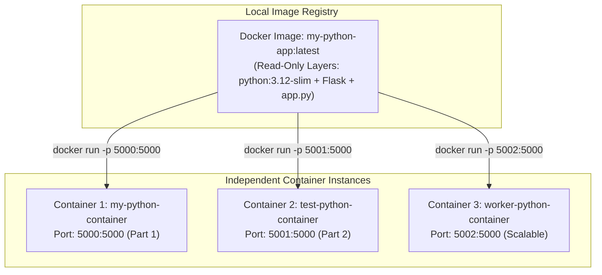

---

### 2. Network Port Forwarding Architecture (`5001:5000`)
In Part 2, port mapping `-p 5001:5000` is configured so that traffic arriving at Windows host port `5001` is forwarded to container port `5000` where Flask is listening.

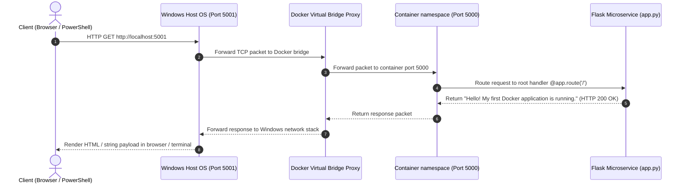

---

### 3. Complete Container Lifecycle Progression
The state diagram below illustrates every state transition executed during Experiment 2:

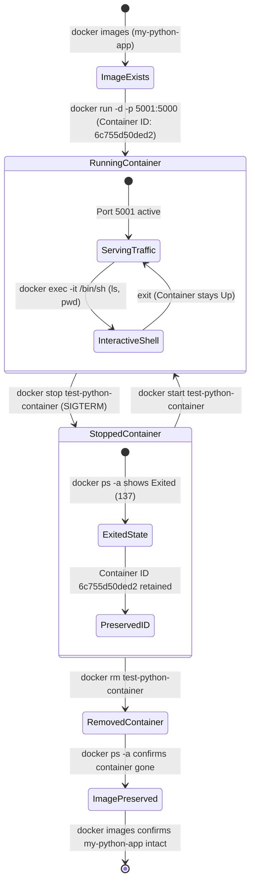

---

## 💻 Step-by-Step Execution Guide (All 18 Lab Steps)

Below is the complete terminal execution log matching all 18 steps from the curriculum manual:

### Step 1: Start Docker Desktop & Verify CLI
```powershell
docker --version
```
*Output*: Returns `Docker version 29.x.x` confirming the Docker engine daemon is responsive on Windows PowerShell.

---

### Step 2: Display Local Docker Images
```powershell
docker images
```
*Output*:
```
REPOSITORY          TAG       IMAGE ID       CREATED        SIZE
my-python-app       latest    be84ed5367f1   12 days ago    200MB
```
*Observation*: Confirms `my-python-app` is already available locally. Rebuilding the image is unnecessary.

---

### Step 3: Create and Run the New Container
```powershell
docker run -d -p 5001:5000 --name test-python-container my-python-app
```
*Output*:
```
6c755d50ded2a5ae4fa6ee11076fdc74c887ce1103963e1cb0da93737c14f4ca
```
*Key Flags*:
- `-d`: Detached mode (runs container in the background as a daemon).
- `-p 5001:5000`: Maps Windows host port `5001` to container port `5000`.
- `--name test-python-container`: Assigns a distinct name to prevent collision with `my-python-container` from Part 1.
- `my-python-app`: Source image template.

---

### Step 4: Check Running Containers
```powershell
docker ps
```
*Output*:
```
CONTAINER ID   IMAGE           COMMAND           CREATED          STATUS         PORTS                                            NAMES
6c755d50ded2   my-python-app   "python app.py"   17 seconds ago   Up 16 seconds  0.0.0.0:5001->5000/tcp, [::]:5001->5000/tcp     test-python-container
```
*Observation*: Container `6c755d50ded2` is `Up` and listening on host port `5001`.

---

### Step 5: Test Web Application in Browser
Open Google Chrome or Microsoft Edge and navigate to:
```
http://localhost:5001
```
*Response*:
```
Hello! My first Docker application is running.
```

---

### Step 6: Test Container Using PowerShell
Verify HTTP communication programmatically without a browser:
```powershell
Invoke-WebRequest http://localhost:5001
(Invoke-WebRequest http://localhost:5001).Content
```
*Output*:
```
StatusCode        : 200
StatusDescription : OK
Content           : Hello! My first Docker application is running.
RawContent        : HTTP/1.1 200 OK
                    Server: Werkzeug/3.0.3 Python/3.12.3
                    Date: Mon, 24 Nov 2026 04:28:10 GMT
                    Content-Type: text/html; charset=utf-8
                    Content-Length: 46
```

---

### Step 7: View Container Logs
```powershell
docker logs test-python-container
```
*Output*:
```
 * Serving Flask app 'app'
 * Debug mode: off
WARNING: This is a development server. Do not use it in a production deployment. Use a production WSGI server instead.
 * Running on all addresses (0.0.0.0)
 * Running on http://127.0.0.1:5000
 * Running on http://172.17.0.2:5000
Press CTRL+C to quit
172.17.0.1 - - [24/Nov/2026 04:28:05] "GET / HTTP/1.1" 200 -
172.17.0.1 - - [24/Nov/2026 04:28:10] "GET / HTTP/1.1" 200 -
```

---

### Step 8: Inspect Container Details
```powershell
docker inspect test-python-container
```
*Key Inspect Fields Validated*:
- `Name`: `"/test-python-container"`
- `State.Status`: `"running"`
- `State.Running`: `true`
- `HostConfig.PortBindings`: `"5000/tcp": [{"HostIp": "", "HostPort": "5001"}]`
- `NetworkSettings.IPAddress`: `"172.17.0.2"`

---

### Step 9: Open an Interactive Shell in the Container
```powershell
docker exec -it test-python-container /bin/sh
```
*Output*:
```
/app #
```
*Flags*:
- `-i`: Interactive (keeps STDIN open).
- `-t`: Allocates a pseudo-TTY terminal.
- `/bin/sh`: Spawns the standard Bourne shell inside the container's isolated Linux namespace.

---

### Step 10: Explore Container Filesystem
While attached inside the container shell:
```sh
# List directory contents
ls

# Verify active working directory path
pwd
```
*Output*:
```
/app # ls
app.py requirements.txt

/app # pwd
/app
```
*Observation*: Confirms that `WORKDIR /app` from the Dockerfile was enforced and the application source code files are present.

---

### Step 11: Exit Container Shell
```sh
/app # exit
```
*Return to Host*: Prompt cleanly returns to `PS C:\Users\chhav>`.  
*Post-Exit Verification*:
```powershell
docker ps
```
*Finding*: `test-python-container` continues running in the background. Exiting the attached interactive shell **does not terminate** the container because the primary server process (`python app.py`, PID 1) remains active.

---

### Step 12: Stop the Container Gracefully
```powershell
docker stop test-python-container
```
*Output*:
```
test-python-container
```
*Verification*: Subsequent execution of `docker ps` confirms that the container is no longer listed in active running containers.

---

### Step 13: Check Stopped Containers
```powershell
docker ps -a
```
*Output*:
```
CONTAINER ID   IMAGE           COMMAND           CREATED         STATUS                       PORTS     NAMES
6c755d50ded2   my-python-app   "python app.py"   9 minutes ago   Exited (137) 21 seconds ago             test-python-container
```
*Observation*: `docker ps -a` captures `test-python-container` in `Exited (137)` state. All container state, logs, and configuration remain safely preserved on disk.

---

### Step 14: Restart the Stopped Container
```powershell
docker start test-python-container
docker ps
```
*Output*:
```
test-python-container
CONTAINER ID   IMAGE           COMMAND           CREATED          STATUS         PORTS                                            NAMES
6c755d50ded2   my-python-app   "python app.py"   10 minutes ago   Up 6 seconds   0.0.0.0:5001->5000/tcp, [::]:5001->5000/tcp     test-python-container
```
*Verification*: The container restarts instantaneously (<0.5s). The HTTP service on `http://localhost:5001` immediately resumes serving traffic.

---

### Step 15: Compare Container ID Persistence
- **Container ID on Initial Creation**: `6c755d50ded2`
- **Container ID after Restart**: `6c755d50ded2`
*Conclusion*: Proves that `docker start` resumes the exact same existing container instance without generating a new container object.

---

### Step 16: Stop and Remove the Container
```powershell
# Stop container
docker stop test-python-container

# Remove container permanently
docker rm test-python-container

# Verify deletion
docker ps -a
```
*Verification*: `test-python-container` is completely absent from `docker ps -a`. Its read-write storage layer and network proxies have been cleanly deallocated.

---

### Step 17: Confirm Image Immutability & Persistence
```powershell
docker images
```
*Output*:
```
REPOSITORY          TAG       IMAGE ID       DISK USAGE   CONTENT SIZE
my-python-app       latest    be84ed5367f1   200MB        49.1MB
```
*Core Takeaway*: Removing a container does **not** delete its parent image. The image `my-python-app:latest` remains intact and immediately ready to spawn future containers.

---

### Step 18: Image Reusability Model
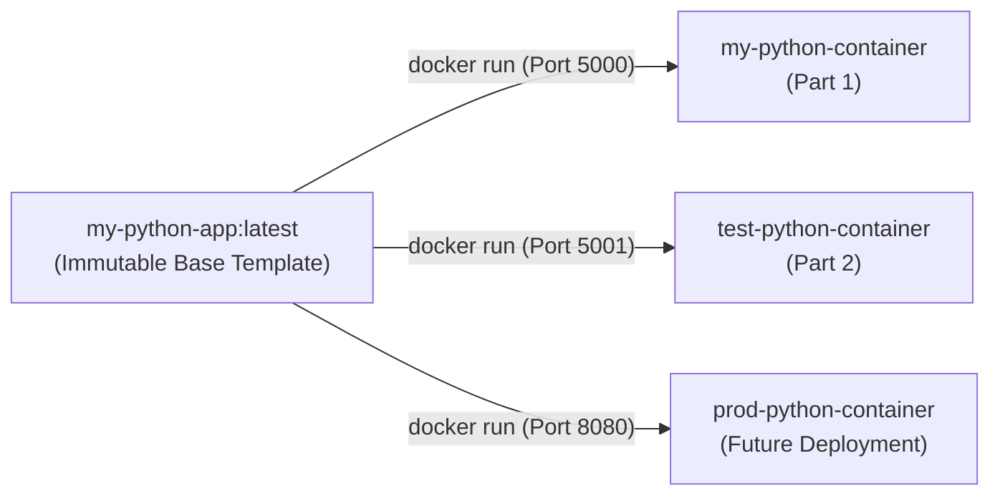
A single Docker image can be reused indefinitely across different ports, host environments, and container configurations.

---

## 📸 Empirical Evidence & Screenshots

### Figure 1: Detached Container Run & Browser Verification
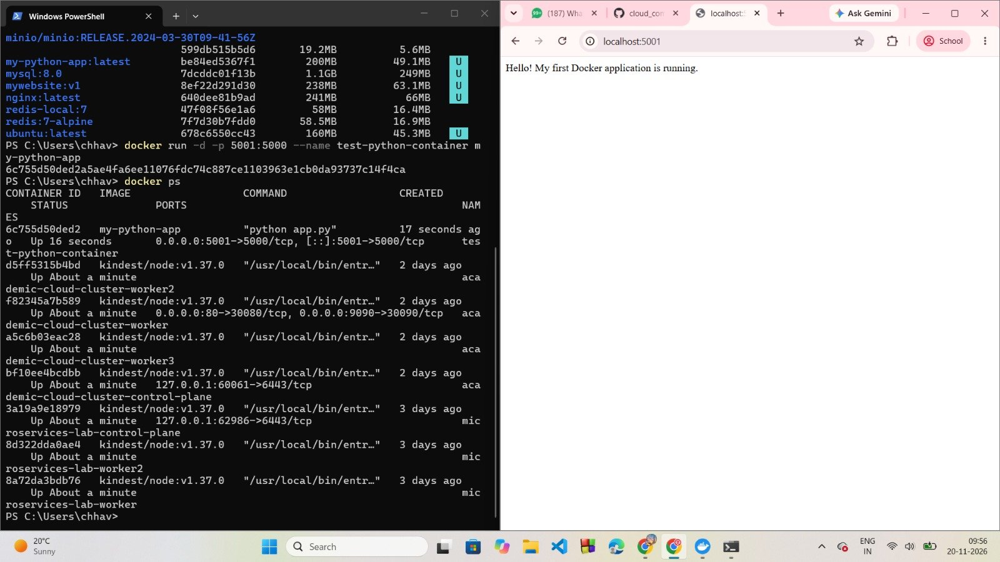
*Figure 1: Side-by-side terminal and browser capture. Left: PowerShell executing `docker run -d -p 5001:5000 --name test-python-container my-python-app` and `docker ps` confirming active container `6c755d50ded2` with port mapping `0.0.0.0:5001->5000/tcp`. Right: Google Chrome browser rendering `http://localhost:5001` showing `"Hello! My first Docker application is running."`.*

---

### Figure 2: Programmatic HTTP Testing via PowerShell (`Invoke-WebRequest`)
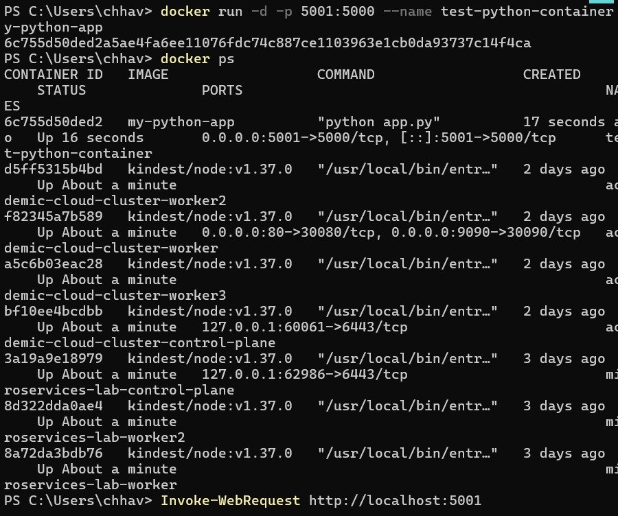
*Figure 2: Windows PowerShell executing `Invoke-WebRequest http://localhost:5001` to test the HTTP endpoint directly from the command line, bypassing the web browser and confirming full TCP round-trip connectivity.*

---

### Figure 3: Interactive Container Shell Access (`docker exec -it /bin/sh`)
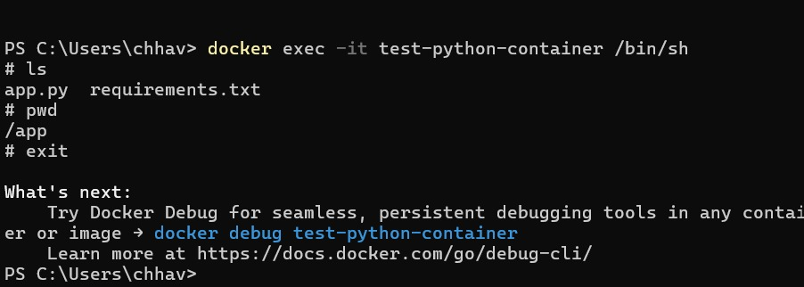
*Figure 3: Interactive in-container shell session. Executing `docker exec -it test-python-container /bin/sh`, listing directory files with `ls` (`app.py`, `requirements.txt`), and verifying working directory with `pwd` (`/app`).*

---

### Figure 4: Graceful Container Stop (`docker stop`)
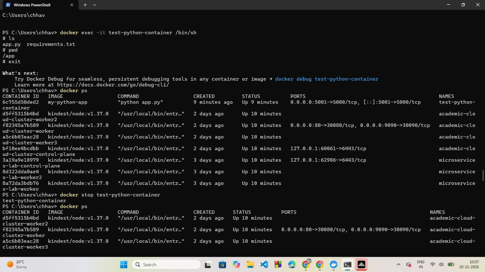
*Figure 4: Terminal showing container inspection followed by `docker stop test-python-container`. Subsequent `docker ps` execution verifies that `test-python-container` has been removed from the active running processes list.*

---

### Figure 5: Inspection of Stopped Containers (`docker ps -a`)
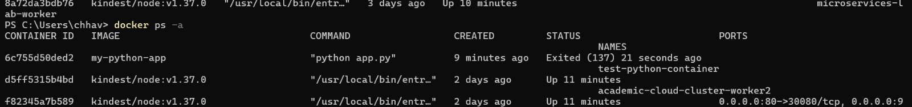
*Figure 5: `docker ps -a` execution capturing `test-python-container` in `Exited (137)` state, confirming container state preservation in host storage.*

---

### Figure 6: Container Restart and Permanent Removal (`docker start` & `docker rm`)
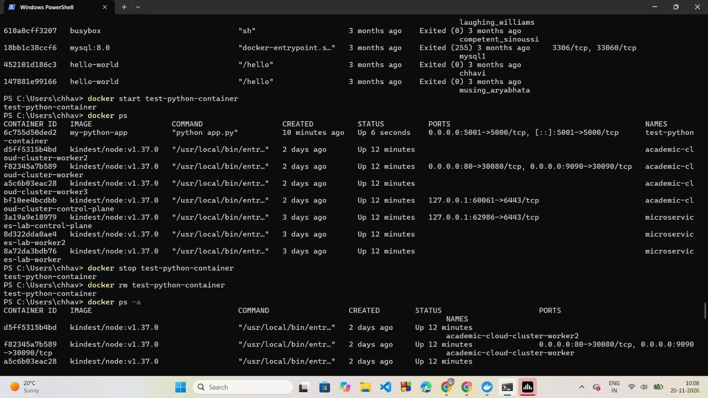
*Figure 6: Complete container lifecycle verification: executing `docker start test-python-container`, verifying running state via `docker ps`, gracefully terminating via `docker stop`, removing via `docker rm test-python-container`, and validating permanent deletion via `docker ps -a`.*

---

### Figure 7: Image Immutability & Persistence Verification (`docker images`)
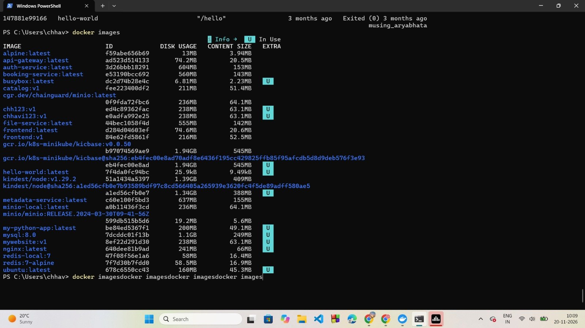
*Figure 7: `docker images` execution after container removal, demonstrating that `my-python-app:latest` (ID: `be84ed5367f1`, 200 MB) remains intact and available for immediate reuse.*

---

## 📊 Container Lifecycle State Transition Matrix

The table below summarizes all observed state transitions throughout the experiment:

| Step / Action | CLI Command | Target State | `docker ps` Output | `docker ps -a` Status | Port 5001 Reachable? | Container ID |
| :--- | :--- | :--- | :--- | :--- | :--- | :--- |
| **1. Instantiate Container** | `docker run -d -p 5001:5000 --name test-python-container my-python-app` | **Running** | Listed (`Up 16s`) | Listed (`Up 16s`) | **Yes (HTTP 200)** | `6c755d50ded2` |
| **2. Attach Shell** | `docker exec -it test-python-container /bin/sh` | **Running** | Listed (`Up 9m`) | Listed (`Up 9m`) | **Yes (HTTP 200)** | `6c755d50ded2` |
| **3. Exit Shell** | `exit` | **Running** | Listed (`Up 9m`) | Listed (`Up 9m`) | **Yes (HTTP 200)** | `6c755d50ded2` |
| **4. Stop Container** | `docker stop test-python-container` | **Stopped** | Not Listed | Listed (`Exited (137)`) | No (Connection Refused)| `6c755d50ded2` |
| **5. Restart Container** | `docker start test-python-container` | **Running** | Listed (`Up 6s`) | Listed (`Up 6s`) | **Yes (HTTP 200)** | `6c755d50ded2` |
| **6. Remove Container** | `docker rm test-python-container` | **Deleted** | Not Listed | Not Listed | No | *Deallocated* |
| **7. Verify Image** | `docker images` | **Persistent** | N/A | N/A | N/A | `be84ed5367f1` *(Intact)*|

---

## 🏁 Conclusion & Key Technical Takeaways

Experiment 2 (Part 2) provided comprehensive empirical validation of Docker container lifecycle operations, runtime debugging, and resource decoupling. Key conclusions derived from this study include:

1. **Decoupled Lifecycle of Images vs. Containers**:
   - Building a Docker image (`docker build`) is a compute- and network-intensive compilation process that packages dependencies, code, and base system binaries into layered read-only blobs.
   - Creating a container (`docker run`) is a near-instantaneous operation (<1.0s) that simply mounts an ephemeral read-write layer over the immutable image and attaches Linux namespaces and cgroups.
   - As demonstrated, once `my-python-app:latest` was built, multiple distinct containers (`my-python-container` on port 5000 and `test-python-container` on port 5001) were instantiated on different ports without ever needing to compile the code again.

2. **Container State & Identity Persistence**:
   - The transition from Running to Stopped via `docker stop` sends a `SIGTERM` followed by a `SIGKILL`, halting CPU execution and releasing host network port proxies without destroying the container's storage layer or configuration.
   - The status `Exited (137)` preserves the container identity. Executing `docker start` resumes the exact same container, maintaining the identical Container ID (`6c755d50ded2`) and filesystem state.

3. **Runtime Non-Destructive Inspection (`docker exec`)**:
   - The `docker exec` command allows system administrators and developers to spawn auxiliary processes (such as `/bin/sh`) inside an active container namespace.
   - Inspecting the directory structure confirmed the application files (`app.py`, `requirements.txt`) and validated that the container's working directory strictly obeyed the Dockerfile directive (`WORKDIR /app`).
   - Closing the shell via `exit` terminates only the secondary shell process, leaving the primary daemon (`python app.py`, PID 1) running without downtime.

4. **Port Multiplexing & Network Isolation**:
   - By publishing separate host ports (`5000` in Part 1 and `5001` in Part 2), multiple concurrent container instances derived from the same base image can operate simultaneously on a single host machine without port collision.
   - Both browser-based navigation and programmatic CLI requests (`Invoke-WebRequest`) verified reliable, bi-directional TCP packet forwarding through the Docker virtual bridge.

5. **Clean Resource Reclamation & Image Immutability**:
   - Stopping and deleting the container via `docker rm test-python-container` completely purges the container's read-write layer and host network proxy bindings.
   - Subsequent execution of `docker images` confirmed that the base image `my-python-app:latest` (ID: `be84ed5367f1`, 200 MB) remained completely intact, proving the fundamental containerization principle: **Containers are ephemeral, but Docker Images are immutable and permanent.**

---

## 🚀 Proceed to Part 3: Push Docker Image to Docker Hub

For the complete standalone documentation covering:
- **Docker CLI Authentication (`docker login`)**
- **Registry Namespace Tagging (`chhavirajeshmishra/my-python-app:v1`)**
- **Layer-Based Image Streaming (`docker push`)**
- **Public Docker Hub Web Portal Verification & Remote Pulling**

👉 **Read the complete report in [**`PART_3_README.md`**](PART_3_README.md)**.

---

## 👤 Student Metadata

- **Student Name**: Chhavi Mishra
- **USN**: `01fe24bci066`
- **Roll No**: `136`
- **Course**: Cloud Computing Laboratory (CS401)
- **Institution**: KLE Technological University, Hubballi
- **Repository**: [https://github.com/chhavi-2006/cloud_computing-](https://github.com/chhavi-2006/cloud_computing-)
