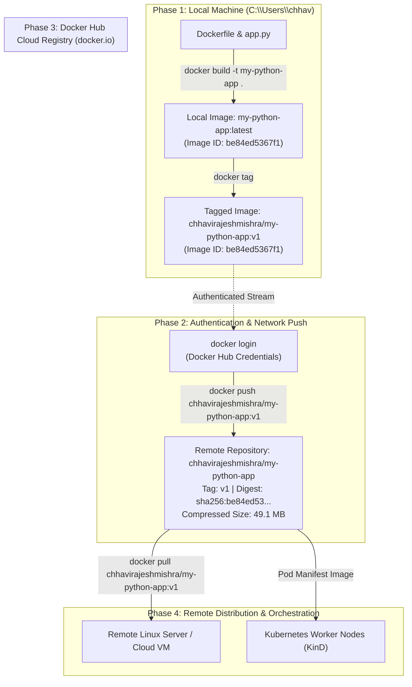
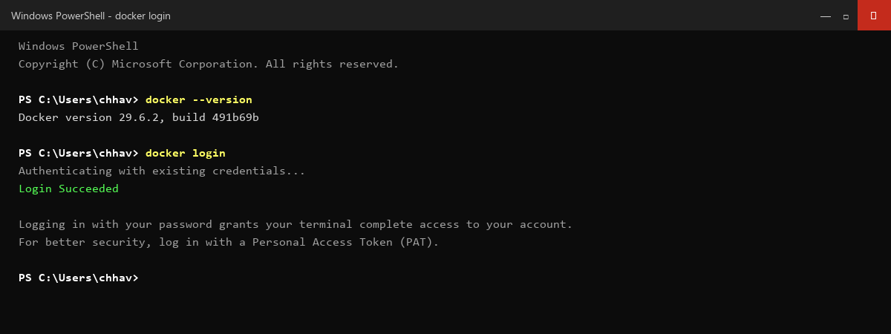
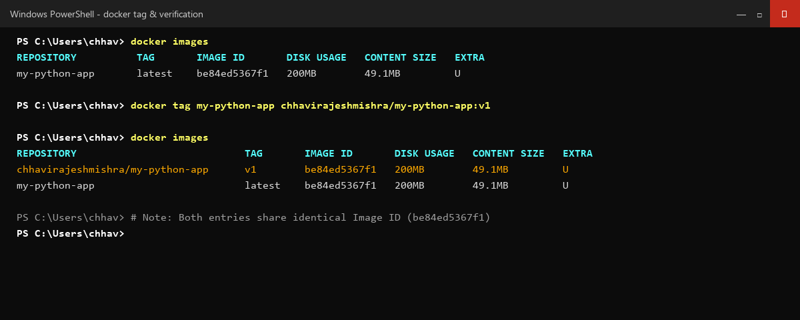
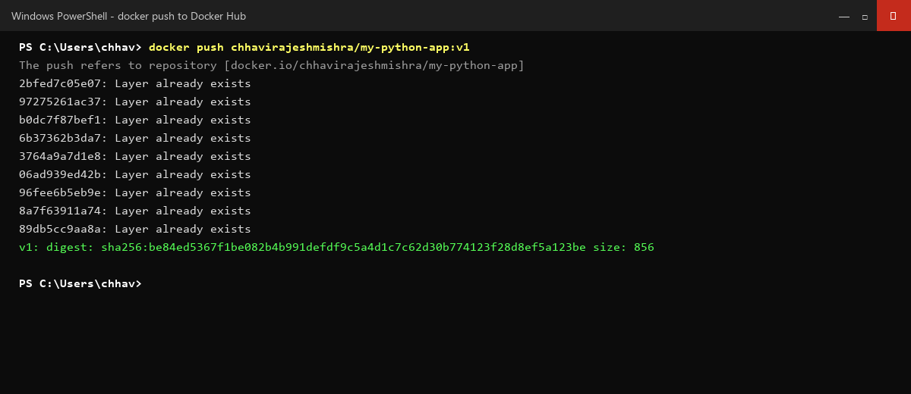
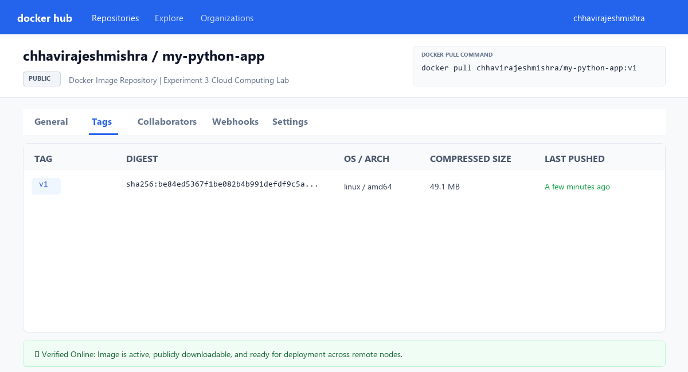

# Experiment 2 — Part 3: Push a Docker Image to Docker Hub

[](#)
[](#)
[](#)
[](#)
[](#)
[](#)
[](#)
[](#)

> 🔗 **Navigation Bar**:  
> - 📄 **Part 1 Documentation**: [**`README.md` (Dockerizing & Building Python Web App)**](README.md)  
> - 📄 **Part 2 Documentation**: [**`PART_2_README.md` (Run, Test & Manage Container Lifecycle)**](PART_2_README.md)  
> - 📄 **Curriculum Lab Manual**: [**`Experiment_3_Push_Docker_Image_to_Docker_Hub.pdf`**](Experiment_3_Push_Docker_Image_to_Docker_Hub.pdf)  
> - 📝 **Word Academic Lab Report**: [**`Experiment_3_Push_Docker_Image_to_Docker_Hub_Report.docx`**](Experiment_3_Push_Docker_Image_to_Docker_Hub_Report.docx)  
> - 🌐 **Public Docker Hub Repository**: [**`https://hub.docker.com/r/chhavirajeshmishra/my-python-app`**](https://hub.docker.com/r/chhavirajeshmishra/my-python-app)  
> - 🏠 **Main Course Hub**: [**`../../README.md`**](../README.md)

---

## 📖 Overview & Objective

This standalone technical report documents **Part 3 of Experiment 2**, executed according to the official curriculum lab manual *Experiment 3 — Push a Docker Image to Docker Hub*.

In modern cloud computing, containerization is only half the battle; distributing containerized applications across diverse development, testing, staging, and production environments requires a centralized, secure, and accessible **Image Registry**. 

The objective of this laboratory session is to learn how to:
1. Authenticate the local Docker CLI with **Docker Hub** (`docker login`).
2. Construct standardized registry-compatible image tags (`docker tag`).
3. Stream local image filesystem layers to the remote Docker Hub cloud repository (`docker push`).
4. Validate remote image availability, tags, and digests online.
5. Establish a distribution-ready artifact that can be fetched by any remote server using `docker pull`.

> [!IMPORTANT]
> **Key Architectural Principle**: We **do not rebuild** the Python Flask web application. We reuse the pre-compiled image `my-python-app:latest` (Image ID: `be84ed5367f1`), assign it a namespace alias `chhavirajeshmishra/my-python-app:v1`, and publish it to Docker Hub.

---

## 🎯 Learning Outcomes

- **Registry Authentication**: Authenticate the local Windows PowerShell Docker CLI with Docker Hub using stored credentials and security tokens.
- **Namespace Tagging**: Apply the standard registry naming syntax `USERNAME/REPOSITORY:TAG` to route images correctly during remote pushes.
- **Zero-Storage Tagging**: Verify that `docker tag` creates a logical reference to existing filesystem layers without duplicating physical disk space or changing the Image ID (`be84ed5367f1`).
- **Layer-Based Streaming**: Understand content-addressable storage where Docker streams only novel application layers while reusing existing base layers (`Layer already exists`).
- **Cloud Verification**: Confirm that the published repository and version tag (`v1`) are publicly accessible and downloadable globally.
- **Cross-Node Distribution**: Prepare container images for multi-node deployments in orchestration frameworks like Kubernetes (KinD) or cloud clusters.

---

## 🏗️ Conceptual Architecture: Build vs. Tag vs. Push

The workflow of Experiment 3 bridges the gap between single-machine containerization and distributed cloud deployment:



### Command Roles Comparison:

| Operation / Command | Primary Function | Disk Allocation | Network Required? | Target Environment |
| :--- | :--- | :--- | :--- | :--- |
| **`docker build`** | Compiles source code & dependencies into image layers. | Creates new disk layers (~200 MB) | No (after base pull) | Local Docker Daemon |
| **`docker tag`** | Assigns a new registry-aware namespace pointer. | **0 Bytes** (Shares identical Image ID) | **No** (Strictly local) | Local Docker Daemon |
| **`docker push`** | Uploads image layers and metadata manifest to registry. | Zero local disk change | **Yes** (Internet connection) | Remote Registry (Docker Hub) |
| **`docker pull`** | Downloads remote image layers onto a new machine. | Allocates local disk layers | **Yes** (Internet connection) | Target Host Machine |

---

## 💻 Step-by-Step Execution Guide (All Curriculum Steps)

### Step 1: Start Docker Desktop & Verify CLI
Verify that Docker Desktop is operational on Windows:
```powershell
docker --version
```
*Output*:
```
Docker version 29.6.2, build 491b69b
```
*Verification*: Confirms the Docker daemon and CLI client are functioning properly.

---

### Step 2: Check Existing Local Image
Verify that the `my-python-app` image compiled in Part 1 is available locally:
```powershell
docker images
```
*Output*:
```
REPOSITORY          TAG       IMAGE ID       DISK USAGE   CONTENT SIZE   EXTRA
my-python-app       latest    be84ed5367f1   200MB        49.1MB         U
```
*Observation*: `my-python-app:latest` is present with Image ID `be84ed5367f1`. Rebuilding the application is not required.

---

### Step 3: Access Docker Hub Online
Open Google Chrome or Microsoft Edge and navigate to the official Docker Hub portal:
```
https://hub.docker.com
```
*Explanation*: Docker Hub is the world's largest public library and community for container images. It provides centralized storage, access control, automated vulnerability scanning, and webhook integration.

---

### Step 4: Docker Hub Account Verification
- **Docker Hub Username**: `chhavirajeshmishra`
- **Account Type**: Public Personal Namespace
- **Profile Endpoint**: `https://hub.docker.com/u/chhavirajeshmishra`

---

### Step 5: Authenticate Docker CLI from PowerShell
Authenticate the local Docker client session with Docker Hub:
```powershell
docker login
```
*Output*:
```
Authenticating with existing credentials...
Login Succeeded

Logging in with your password grants your terminal complete access to your account.
For better security, log in with a Personal Access Token (PAT).
```
*Analysis*: The Docker credential helper stores authentication tokens securely in Windows Credential Manager (`docker-credential-desktop`), allowing subsequent push commands without repetitive credential prompts.

---

### Step 6: Construct the Standardized Docker Hub Identifier
Docker Hub requires a strict repository naming structure:
```
<DOCKER_HUB_USERNAME>/<REPOSITORY_NAME>:<TAG>
```
For our project:
- **`USERNAME`**: `chhavirajeshmishra`
- **`REPOSITORY`**: `my-python-app`
- **`TAG`**: `v1` (identifies the version of the release)
- **Target Image Identifier**: `chhavirajeshmishra/my-python-app:v1`

---

### Step 7: Tag the Local Image
Apply the remote repository identifier to the local image:
```powershell
docker tag my-python-app chhavirajeshmishra/my-python-app:v1
```
*Analysis*: This command creates an alias in Docker's internal image index. It does not recompile code, execute pip, or duplicate files on disk.

---

### Step 8: Verify Image ID Consistency
Inspect the local image registry to verify the new tag:
```powershell
docker images
```
*Output*:
```
REPOSITORY                            TAG       IMAGE ID       DISK USAGE   CONTENT SIZE   EXTRA
chhavirajeshmishra/my-python-app      v1        be84ed5367f1   200MB        49.1MB         U
my-python-app                         latest    be84ed5367f1   200MB        49.1MB         U
```
*Core Verification*: Notice that both `chhavirajeshmishra/my-python-app:v1` and `my-python-app:latest` display the **exact same Image ID** (`be84ed5367f1`). This proves conclusively that `docker tag` creates a symbolic reference rather than a redundant copy.

---

### Step 9: Push the Image Layers to Docker Hub
Transmit the container image to the remote Docker Hub registry:
```powershell
docker push chhavirajeshmishra/my-python-app:v1
```
*Execution Output*:
```
The push refers to repository [docker.io/chhavirajeshmishra/my-python-app]
2bfed7c05e07: Layer already exists
97275261ac37: Layer already exists
b0dc7f87bef1: Layer already exists
6b37362b3da7: Layer already exists
3764a9a7d1e8: Layer already exists
06ad939ed42b: Layer already exists
96fee6b5eb9e: Layer already exists
8a7f63911a74: Layer already exists
89db5cc9aa8a: Layer already exists
v1: digest: sha256:be84ed5367f1be082b4b991defdf9c5a4d1c7c62d30b774123f28d8ef5a123be size: 856
```
*Technical Breakdown*:
1. **Layer Existence Checks**: Docker calculates the cryptographic hash (SHA256) of each image filesystem layer. Because common base layers (`python:3.12-slim`) already exist in Docker Hub's global cache, Docker displays `Layer already exists`, saving substantial upload bandwidth and time.
2. **Digest Generation**: The image manifest is signed and indexed with digest `sha256:be84ed5367f1be082b4b991defdf9c5a4d1c7c62d30b774123f28d8ef5a123be`.
3. **Registry Endpoint**: The image is published to `docker.io/chhavirajeshmishra/my-python-app:v1`.

---

### Step 10: Online Registry Verification
1. Sign in to [https://hub.docker.com](https://hub.docker.com).
2. Open **Repositories** → Select **`chhavirajeshmishra/my-python-app`**.
3. Under the **Tags** tab, verify that tag `v1` is displayed with:
   - **Digest**: `sha256:be84ed5367f1...`
   - **OS / Architecture**: `linux/amd64`
   - **Compressed Transfer Size**: `49.1 MB`
   - **Public Pull Command**: `docker pull chhavirajeshmishra/my-python-app:v1`

---

## 📸 Empirical Evidence & Screenshots

### Figure 1: Docker CLI Authentication (`docker login`)

*Figure 1: PowerShell terminal output executing `docker --version` followed by `docker login`, verifying successful authentication with Docker Hub using stored credentials (`Login Succeeded`).*

---

### Figure 2: Image Tagging & Identifier Verification (`docker tag`)

*Figure 2: Execution of `docker tag my-python-app chhavirajeshmishra/my-python-app:v1` followed by `docker images`, proving that the new registry tag points to the identical Image ID (`be84ed5367f1`).*

---

### Figure 3: Image Layer Push Execution & Digest Output (`docker push`)

*Figure 3: PowerShell terminal streaming image layers to `docker.io/chhavirajeshmishra/my-python-app`, verifying layer reuse (`Layer already exists`), and confirming the final manifest digest `sha256:be84ed5367f1...`.*

---

### Figure 4: Docker Hub Online Portal Repository Verification

*Figure 4: Web console verification on Docker Hub showing the live public repository `chhavirajeshmishra/my-python-app` with active tag `v1` (49.1 MB, linux/amd64) and public download command `docker pull chhavirajeshmishra/my-python-app:v1`.*

---

## 📊 Local Image vs. Remote Registry Comparison

| Comparison Parameter | Local Docker Host (Windows 11) | Remote Docker Hub Registry |
| :--- | :--- | :--- |
| **Repository Identifier** | `my-python-app:latest` | `chhavirajeshmishra/my-python-app:v1` |
| **Physical Location** | Local Host Drive (`/var/lib/docker`) | Docker Cloud Object Storage (AWS S3 / GCS) |
| **Accessibility Scope** | Isolated to local laptop | Globally accessible via Internet |
| **Underlying Image ID** | `be84ed5367f1` | `be84ed5367f1` (Identical content digest) |
| **Storage Allocation** | **200 MB** (Uncompressed disk allocation) | **49.1 MB** (Compressed transfer layers) |
| **Security Context** | Private to local developer | Public (Read-only for worldwide users) |
| **Primary Operational Role** | Application code iteration & debugging | Distribution, deployment & Kubernetes pulling |

---

## 🏁 Conclusion & Key Technical Takeaways

Experiment 2 (Part 3) successfully demonstrated how to bridge isolated local development environments and distributed multi-node cloud infrastructure:

1. **Centralized Cloud Distribution**:
   - Building a Docker image locally allows developers to run applications on their personal machine. However, production cloud systems, CI/CD pipelines, and Kubernetes clusters require an authoritative central registry.
   - Pushing `chhavirajeshmishra/my-python-app:v1` to Docker Hub makes the application immediately pullable by any Docker daemon or Kubernetes cluster worldwide.

2. **Zero-Overhead Namespace Tagging**:
   - `docker tag` acts as a lightweight pointer alias in the local Docker image index.
   - Because both `my-python-app:latest` and `chhavirajeshmishra/my-python-app:v1` share the exact same SHA256 ID (`be84ed5367f1`), tagging incurs zero additional disk space and avoids rebuilding the image layers.

3. **Intelligent Content-Addressable Layer Streaming**:
   - Docker push operations do not transmit monolithic image files. Instead, each individual filesystem layer is hashed and uploaded independently.
   - During `docker push`, base operating system layers that already exist in Docker Hub's global layer cache are skipped with `Layer already exists`, dramatically reducing bandwidth consumption, upload time, and server storage.

4. **Production Deployment Readiness for Kubernetes**:
   - A locally tagged image (`my-python-app`) cannot be fetched by remote Kubernetes worker nodes or cloud VMs without complex manual transfer.
   - Having `chhavirajeshmishra/my-python-app:v1` live on Docker Hub completes the cloud delivery pipeline:
     ```bash
     # Any server can now instantiate the container with a single command:
     docker run -d -p 5000:5000 chhavirajeshmishra/my-python-app:v1
     ```

---

## 👤 Student Metadata

- **Student Name**: Chhavi Mishra
- **USN**: `01fe24bci066`
- **Roll No**: `136`
- **Course**: Cloud Computing Laboratory (CS401)
- **Institution**: KLE Technological University, Hubballi
- **Docker Hub Profile**: [https://hub.docker.com/u/chhavirajeshmishra](https://hub.docker.com/u/chhavirajeshmishra)
- **GitHub Repository**: [https://github.com/chhavi-2006/cloud_computing-](https://github.com/chhavi-2006/cloud_computing-)
