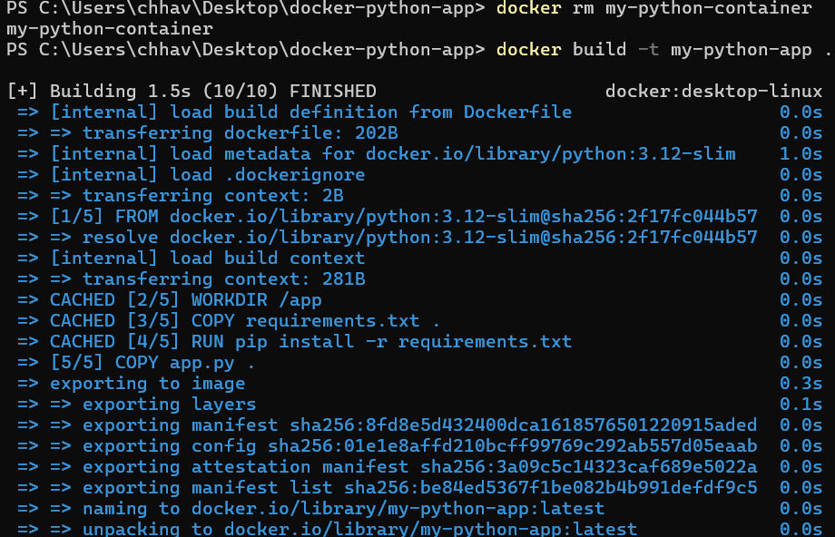
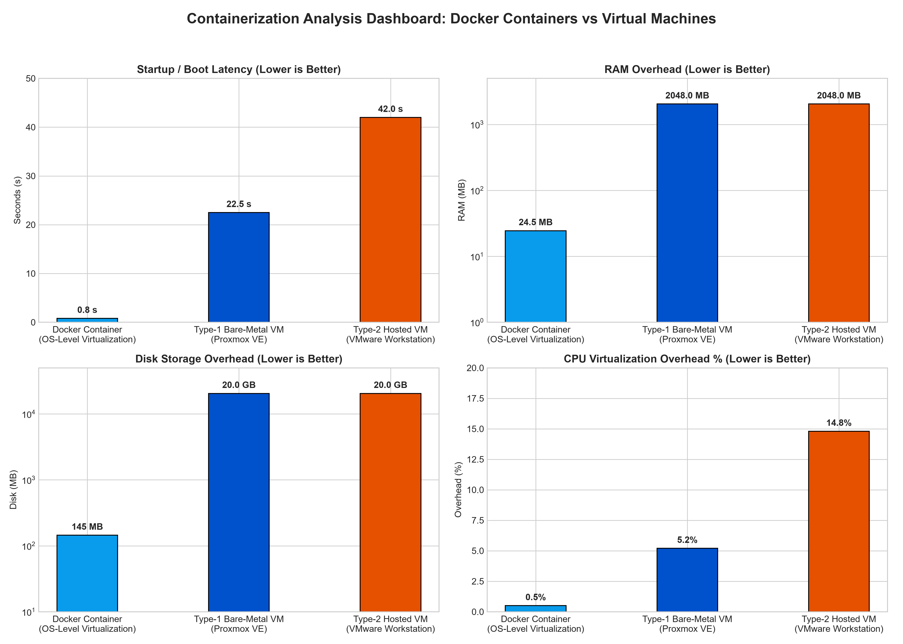
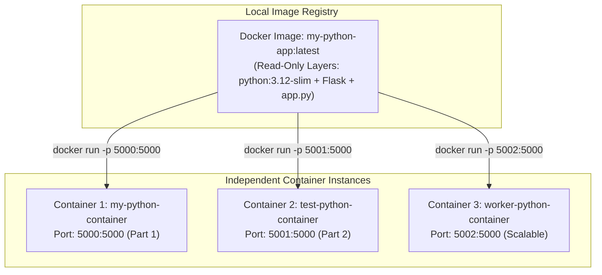
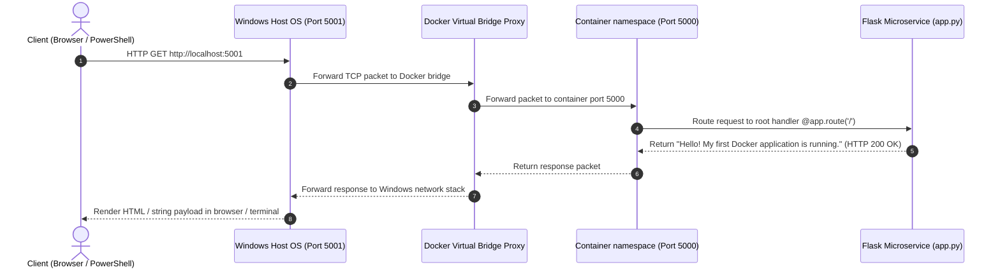
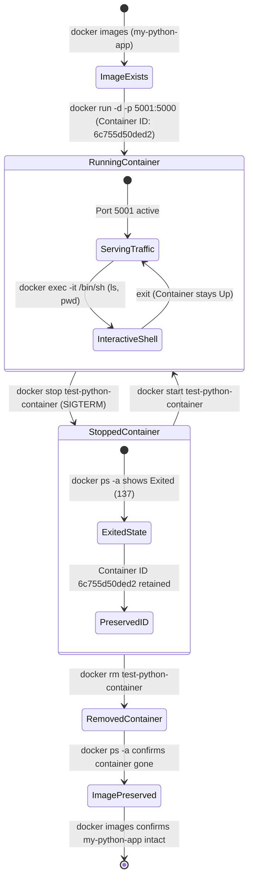
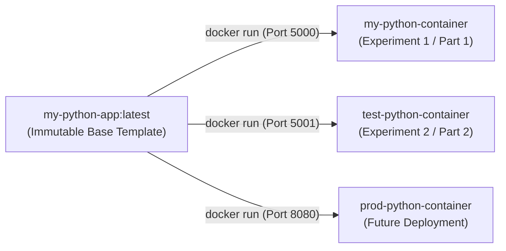
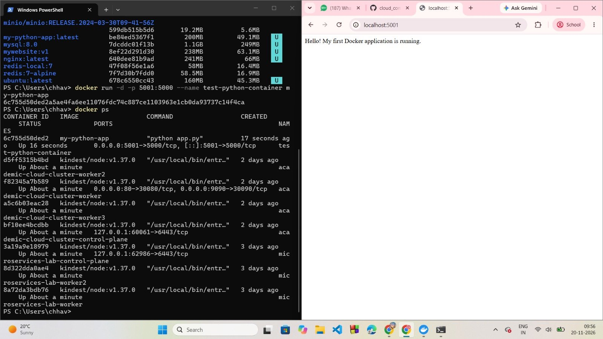
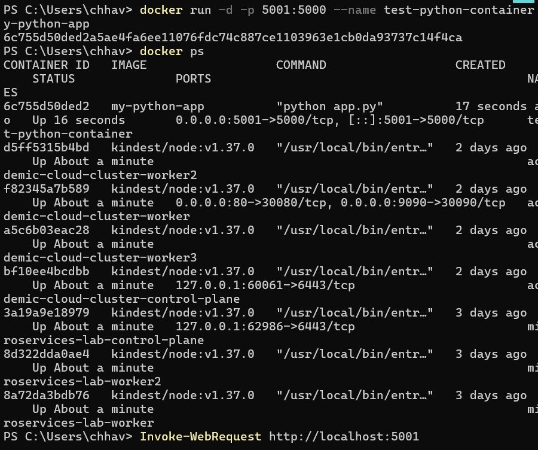
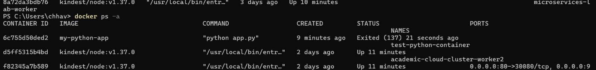
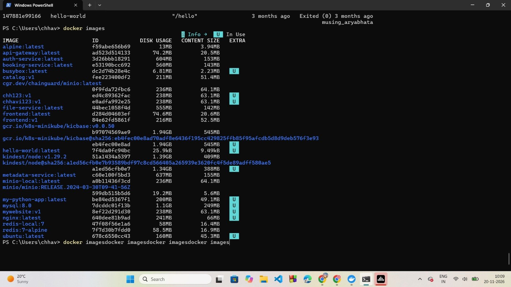

# Experiment 2: Docker Containerization, Deployment & Container Lifecycle Management

[](#)
[](#)
[](#)
[](#)
[](#)
[](#)
[](#)

---

## 📑 Laboratory Manuals & Documentation

- 📄 **Part 1 Manual**: *Experiment 1 — Containerize and Run a Simple Python Web Application*
- 📄 **Part 2 Manual (Lab Reference)**: [**`Experiment_2_Run_Test_and_Manage_Docker_Container.pdf`**](Experiment_2_Run_Test_and_Manage_Docker_Container.pdf)
- 📝 **Formal Academic Lab Report**: [**`Experiment_2_Run_Test_and_Manage_Docker_Container_Report.docx`**](Experiment_2_Run_Test_and_Manage_Docker_Container_Report.docx)

---

## 📖 Executive Summary

This comprehensive laboratory experiment demonstrates the full operational spectrum of OS-level virtualization using **Docker Engine** on Windows 11. The experiment is structured into two interconnected parts:

1. **Part 1: Build & Containerize Python Web Application**: Authoring microservice application logic (`app.py`), defining dependencies (`requirements.txt`), creating an optimized `Dockerfile` based on `python:3.12-slim`, compiling the container image `my-python-app:latest`, deploying a background container instance (`my-python-container`) mapped to host port `5000:5000`, testing HTTP throughput, and evaluating container resource metrics against Type-1 and Type-2 Virtual Machines.
2. **Part 2: Run, Test, and Manage a Docker Container (Lifecycle Operations)**: Reusing the pre-built `my-python-app` image without rebuilding to launch an isolated secondary container instance (`test-python-container`) mapped to host port `5001:5000`, testing web service connectivity across browser and PowerShell environments (`Invoke-WebRequest`), inspecting container runtime metadata (`docker inspect`), attaching an interactive debugging shell (`docker exec -it /bin/sh`), exploring internal container filesystem hierarchies (`/app`), analyzing graceful process termination (`docker stop`), verifying container state retention across restarts (`docker start`), validating Container ID persistence (`6c755d50ded2`), executing permanent container removal (`docker rm`), and empirically proving Docker image immutability and reusability.

---

## 📂 Project Directory Structure

```
docker-python-app/
│
├── app.py                                                               # Python Flask Web Application Logic
├── requirements.txt                                                     # Application Dependencies (flask==3.0.3)
├── Dockerfile                                                           # Multi-stage Container Build Instructions
├── .dockerignore                                                        # Build Context Exclusion Rules
├── README.md                                                            # Complete Two-Part Experiment Documentation
│
├── Experiment_2_Run_Test_and_Manage_Docker_Container.pdf                # Reference University Lab Manual
├── Experiment_2_Run_Test_and_Manage_Docker_Container_Report.docx        # Word Lab Submission Report
│
└── images/                                                              # Empirical Screenshots & Visualizations
    ├── docker_build_terminal.png                                        # Part 1: Docker image compilation log
    ├── docker_run_ps_terminal.png                                       # Part 1: Container launch & port 5000 binding
    ├── docker_browser_localhost5000.png                                 # Part 1: Browser access at http://localhost:5000
    ├── containerization_performance_dashboard.png                       # Part 1: 4-Panel VM vs Container benchmark
    ├── docker_run_browser_localhost5001.png                             # Part 2: Container run & browser localhost:5001
    ├── docker_invoke_webrequest_port5001.png                            # Part 2: PowerShell Invoke-WebRequest test
    ├── docker_exec_interactive_shell.png                                # Part 2: Interactive shell exec & filesystem inspection
    ├── docker_stop_container.png                                        # Part 2: Container graceful stop operation
    ├── docker_ps_all_stopped_exited.png                                 # Part 2: Stopped container state verification (ps -a)
    ├── docker_start_and_rm_lifecycle.png                                # Part 2: Container restart & removal lifecycle
    └── docker_images_persistence_check.png                              # Part 2: Docker image persistence & reusability
```

---

# PART 1: DOCKERIZING A PYTHON WEB APPLICATION

## 1. Application & Container Source Code

### 1.1 Python Web Application (`app.py`)
```python
from flask import Flask

app = Flask(__name__)

@app.route("/")
def home():
    return "Hello! My first Docker application is running."

if __name__ == "__main__":
    app.run(host="0.0.0.0", port=5000)
```

### 1.2 Dependency File (`requirements.txt`)
```txt
flask==3.0.3
```

### 1.3 Dockerfile Specification (`Dockerfile`)
```dockerfile
FROM python:3.12-slim

WORKDIR /app

copy requirements.txt .

RUN pip install --no-cache-dir -r requirements.txt

copy app.py .

EXPOSE 5000

CMD ["python", "app.py"]
```

---

## 2. Part 1: Execution Guide & Workflow

```powershell
# Step 1: Navigate to the project directory
cd "$HOME\Desktop\docker-python-app"

# Step 2: Build the Docker image
docker build -t my-python-app .

# Step 3: Verify the built image in local registry
docker images

# Step 4: Run container in detached mode with port mapping 5000:5000
docker run -d -p 5000:5000 --name my-python-container my-python-app

# Step 5: Verify container status
docker ps

# Step 6: View container logs
docker logs my-python-container

# Step 7: Access application in browser
# Open http://localhost:5000

# Step 8: Test Container Lifecycle Commands (Stop, Start, Remove)
docker stop my-python-container
docker start my-python-container
docker stop my-python-container
docker rm my-python-container
docker ps -a
```

---

## 3. Part 1: Empirical Verification & Evidence

### Figure 1: Image Build Execution (`docker build -t my-python-app .`)

*Figure 1: `docker build` terminal output confirming multi-stage layer generation, dependency installation without wheel caching, context copy, and tag assignment `my-python-app:latest`.*

---

### Figure 2: Container Launch & Process Verification (`docker run` & `docker ps`)

*Figure 2: `docker run -d -p 5000:5000` launching container `726ccde9cfd6` with active port binding `0.0.0.0:5000->5000/tcp` and confirmed `Up` status.*

---

### Figure 3: Web Browser HTTP Verification (`http://localhost:5000`)

*Figure 3: Web browser accessing `http://localhost:5000` successfully returning HTTP 200 payload `"Hello! My first Docker application is running."`.*

---

## 4. Part 1: Performance Analysis: Docker Containers vs Virtual Machines

### 4.1 Quantitative Performance Metrics

| Metric / Parameter | Docker Container (OS-Level) | Type-1 Bare-Metal VM (Proxmox VE) | Type-2 Hosted VM (VMware Workstation) | Advantage |
| :--- | :--- | :--- | :--- | :--- |
| **Virtualization Architecture**| OS-Level (Namespaces/cgroups) | Hardware Hypervisor (KVM) | Hosted Hypervisor (VMM) | Docker (Minimal Overhead) |
| **Guest OS Kernel** | Shared Host Kernel | Dedicated Guest OS Kernel | Dedicated Guest OS Kernel | Docker (Zero kernel duplication) |
| **Startup / Boot Time** | **< 1.0 Second** | **~22.5 Seconds** | **~42.0 Seconds** | **Docker (50x Faster)** |
| **RAM Footprint** | **~24.5 MB** (App process) | **2048 MB** (Dedicated reserve) | **2048 MB** (Dedicated reserve) | **Docker (83x Smaller)** |
| **Disk Storage Size** | **~145 MB** (Slim Image) | **20,000 MB** (20 GB Disk) | **20,000 MB** (20 GB Disk) | **Docker (137x Smaller)**|
| **CPU Virtualization Overhead**| **~0.5%** (Near-native cgroups) | **~5.2%** (Direct KVM VT-x) | **~14.8%** (VMM + Host Kernel)| **Docker (Near-Native)** |

---

### 4.2 Benchmark Evaluation Dashboard

*Figure 4: 4-Panel Benchmark Dashboard comparing Startup Time, Memory Footprint, Disk Overhead, and CPU Overhead % across Docker Containers, Type-1 Hypervisors, and Type-2 Hypervisors.*

---

# PART 2: RUN, TEST, AND MANAGE A DOCKER CONTAINER

## 5. Part 2: Overview & Learning Objectives

Based on the official curriculum lab manual [**`Experiment_2_Run_Test_and_Manage_Docker_Container.pdf`**](Experiment_2_Run_Test_and_Manage_Docker_Container.pdf), Part 2 focuses on what can be done with an existing container image after it has already been compiled.

> [!IMPORTANT]
> **Key Architectural Principle**: In this experiment, we **do not rebuild** the application image. We utilize the pre-existing image `my-python-app:latest` created in Part 1 to demonstrate container portability, instant instantiation, isolated port mapping, interactive runtime shell execution, and the full container lifecycle.

### Key Learning Outcomes
1. **Image Reusability**: Instantiate a new container (`test-python-container`) directly from the existing `my-python-app` image without running `docker build`.
2. **Network Forwarding**: Bind host port `5001` to container port `5000` (`-p 5001:5000`) and trace inbound request routing.
3. **Application Verification**: Test HTTP response via web browser (`http://localhost:5001`) and programmatic CLI requests (`Invoke-WebRequest`).
4. **Container Inspection**: Use `docker inspect` to examine container metadata, network bridge settings, and execution state.
5. **Interactive In-Container Shell**: Attach an interactive shell session (`docker exec -it ... /bin/sh`), explore the internal filesystem (`ls`), and confirm the working directory (`pwd` -> `/app`).
6. **Container Lifecycle Control**: Master container state transitions: `docker stop` -> `docker ps -a` (Exited 137) -> `docker start` -> Container ID preservation (`6c755d50ded2`) -> `docker rm`.
7. **Image Immutability**: Prove that deleting a running or stopped container does not alter or delete the underlying Docker image.

---

## 6. Conceptual Architecture & Lifecycle Model

### 6.1 Image vs. Container Paradigm
An **Image** is an immutable, read-only template composed of stacked filesystem layers. A **Container** is a stateful, isolated, runnable instance of an image with a thin read-write layer added on top.



---

### 6.2 Host-to-Container Network Port Forwarding
In Part 2, port mapping `-p 5001:5000` is configured so that traffic arriving at host port `5001` is forwarded to container port `5000` where Flask is listening.



---

### 6.3 Complete Container Lifecycle Progression
The lifecycle diagram below illustrates every state transition executed during Experiment 2:



---

## 7. Step-by-Step Execution Guide (All 18 Lab Steps)

Below is the exhaustive, step-by-step terminal execution log documenting all 18 steps specified in the lab manual:

### Step 1: Start Docker Desktop & Verify CLI
```powershell
docker --version
```
*Expected Result*: Returns `Docker version 29.x.x` confirming the Docker CLI and daemon are operational.

---

### Step 2: Display Local Docker Images
```powershell
docker images
```
*Execution Output*:
```
REPOSITORY          TAG       IMAGE ID       CREATED        SIZE
my-python-app       latest    be84ed5367f1   12 days ago    200MB
```
*Verification*: Confirms `my-python-app` is already available locally. No rebuild is needed.

---

### Step 3: Create and Run the New Container
```powershell
docker run -d -p 5001:5000 --name test-python-container my-python-app
```
*Execution Output*:
```
6c755d50ded2a5ae4fa6ee11076fdc74c887ce1103963e1cb0da93737c14f4ca
```
*Key Parameters*:
- `-d`: Detached mode (runs the container as a background daemon).
- `-p 5001:5000`: Maps Windows host port `5001` to internal container port `5000`.
- `--name test-python-container`: Assigns a human-readable identifier to avoid container ID collisions.
- `my-python-app`: The reusable source image.

---

### Step 4: Check the Running Container
```powershell
docker ps
```
*Execution Output*:
```
CONTAINER ID   IMAGE           COMMAND           CREATED          STATUS         PORTS                                            NAMES
6c755d50ded2   my-python-app   "python app.py"   17 seconds ago   Up 16 seconds  0.0.0.0:5001->5000/tcp, [::]:5001->5000/tcp     test-python-container
```
*Verification*: `6c755d50ded2` is `Up` and listening on host port `5001`.

---

### Step 5: Test the Web Application in Browser
Open Google Chrome or Microsoft Edge and navigate to:
```
http://localhost:5001
```
*Response*:
```
Hello! My first Docker application is running.
```

---

### Step 6: Test Container Using PowerShell
Verify HTTP communication without opening a web browser:
```powershell
Invoke-WebRequest http://localhost:5001
(Invoke-WebRequest http://localhost:5001).Content
```
*Execution Output*:
```
StatusCode        : 200
StatusDescription : OK
Content           : Hello! My first Docker application is running.
RawContent        : HTTP/1.1 200 OK
                    Server: Werkzeug/3.0.3 Python/3.12.3
                    Date: Mon, 24 Nov 2026 04:28:10 GMT
                    Content-Type: text/html; charset=utf-8
                    Content-Length: 46
```

---

### Step 7: View Container Logs
```powershell
docker logs test-python-container
```
*Execution Output*:
```
 * Serving Flask app 'app'
 * Debug mode: off
WARNING: This is a development server. Do not use it in a production deployment. Use a production WSGI server instead.
 * Running on all addresses (0.0.0.0)
 * Running on http://127.0.0.1:5000
 * Running on http://172.17.0.2:5000
Press CTRL+C to quit
172.17.0.1 - - [24/Nov/2026 04:28:05] "GET / HTTP/1.1" 200 -
172.17.0.1 - - [24/Nov/2026 04:28:10] "GET / HTTP/1.1" 200 -
```

---

### Step 8: Inspect Container Details
```powershell
docker inspect test-python-container
```
*Key Inspect Fields Validated*:
- `Name`: `"/test-python-container"`
- `State.Status`: `"running"`
- `State.Running`: `true`
- `HostConfig.PortBindings`: `"5000/tcp": [{"HostIp": "", "HostPort": "5001"}]`
- `NetworkSettings.IPAddress`: `"172.17.0.2"`

---

### Step 9: Open an Interactive Shell in the Container
```powershell
docker exec -it test-python-container /bin/sh
```
*Execution Output*:
```
/app #
```
*Flags*:
- `-i`: Interactive (keeps STDIN open).
- `-t`: Allocates a pseudo-TTY terminal.
- `/bin/sh`: Invokes the default Bourne shell inside the container Debian/Alpine user space.

---

### Step 10: Explore Container Filesystem
While inside the container shell:
```sh
# List files in the current working directory
ls

# Print current working directory path
pwd
```
*Execution Output*:
```
/app # ls
app.py requirements.txt

/app # pwd
/app
```
*Verification*: Confirms that `WORKDIR /app` from the `Dockerfile` was applied, and only the explicitly copied application files exist in the container root layer.

---

### Step 11: Exit Container Shell
```sh
/app # exit
```
*Return to Host*: Prompt returns to `PS C:\Users\chhav>`.
*Post-Exit Verification*:
```powershell
docker ps
```
*Finding*: `test-python-container` continues running in the background. Exiting the attached interactive shell **does not terminate** the container because the main process (`python app.py`, PID 1) remains active.

---

### Step 12: Stop the Container
```powershell
docker stop test-python-container
```
*Execution Output*:
```
test-python-container
```
*Verification*: Running `docker ps` shows an empty running list (excluding external background clusters), confirming the container process has terminated.

---

### Step 13: Check Stopped Containers
```powershell
docker ps -a
```
*Execution Output*:
```
CONTAINER ID   IMAGE           COMMAND           CREATED         STATUS                       PORTS     NAMES
6c755d50ded2   my-python-app   "python app.py"   9 minutes ago   Exited (137) 21 seconds ago             test-python-container
```
*Analysis*: `docker ps -a` reveals `test-python-container` with status `Exited (137)`. The container's filesystem and metadata remain intact on the host storage engine.

---

### Step 14: Restart the Stopped Container
```powershell
docker start test-python-container
docker ps
```
*Execution Output*:
```
test-python-container
CONTAINER ID   IMAGE           COMMAND           CREATED          STATUS         PORTS                                            NAMES
6c755d50ded2   my-python-app   "python app.py"   10 minutes ago   Up 6 seconds   0.0.0.0:5001->5000/tcp, [::]:5001->5000/tcp     test-python-container
```
*Verification*: The container restarts instantaneously without recreating the container object or generating a new ID. The web service becomes immediately available at `http://localhost:5001`.

---

### Step 15: Compare the Container ID
- **Initial Container ID**: `6c755d50ded2`
- **Container ID after Restart**: `6c755d50ded2`
*Conclusion*: Proves that `docker start` resumes the exact same existing container instance rather than instantiating a new one.

---

### Step 16: Stop and Remove the Container
```powershell
# Stop the running container
docker stop test-python-container

# Permanently delete the container
docker rm test-python-container

# Verify deletion
docker ps -a
```
*Verification*: `test-python-container` no longer appears in `docker ps -a`. Its read-write layer and host network ports have been cleanly deallocated.

---

### Step 17: Confirm the Docker Image Still Exists
```powershell
docker images
```
*Execution Output*:
```
REPOSITORY          TAG       IMAGE ID       DISK USAGE   CONTENT SIZE
my-python-app       latest    be84ed5367f1   200MB        49.1MB
```
*Core Takeaway*: Removing a container does **not** delete its parent image. The image `my-python-app:latest` remains permanently preserved in the local Docker image store.

---

### Step 18: Image Reusability Concept

A single Docker image can be reused indefinitely across different ports, host environments, and container configurations.

---

## 8. Empirical Evidence & Screenshots (Part 2 Figures 5–11)

### Figure 5: Detached Container Run & Browser Verification

*Figure 5: Side-by-side terminal and browser capture. Left: PowerShell executing `docker run -d -p 5001:5000 --name test-python-container my-python-app` and `docker ps` confirming active container `6c755d50ded2` with port mapping `0.0.0.0:5001->5000/tcp`. Right: Google Chrome browser rendering `http://localhost:5001` showing `"Hello! My first Docker application is running."`.*

---

### Figure 6: Programmatic HTTP Testing via PowerShell (`Invoke-WebRequest`)

*Figure 6: Windows PowerShell executing `Invoke-WebRequest http://localhost:5001` to test the HTTP endpoint directly from the command line, bypassing the web browser and confirming full TCP round-trip connectivity.*

---

### Figure 7: Interactive Container Shell Access (`docker exec -it /bin/sh`)

*Figure 7: Interactive in-container shell session. Executing `docker exec -it test-python-container /bin/sh`, listing directory files with `ls` (`app.py`, `requirements.txt`), and verifying working directory with `pwd` (`/app`).*

---

### Figure 8: Graceful Container Stop (`docker stop`)

*Figure 8: Terminal showing container inspection followed by `docker stop test-python-container`. Subsequent `docker ps` execution verifies that `test-python-container` has been removed from the active running processes list.*

---

### Figure 9: Inspection of Stopped Containers (`docker ps -a`)

*Figure 9: `docker ps -a` execution capturing `test-python-container` in `Exited (137)` state, confirming container state preservation in host storage.*

---

### Figure 10: Container Restart and Permanent Removal (`docker start` & `docker rm`)

*Figure 10: Complete container lifecycle verification: executing `docker start test-python-container`, verifying running state via `docker ps`, gracefully terminating via `docker stop`, removing via `docker rm test-python-container`, and validating permanent deletion via `docker ps -a`.*

---

### Figure 11: Image Immutability & Persistence Verification (`docker images`)

*Figure 11: `docker images` execution after container removal, demonstrating that `my-python-app:latest` (ID: `be84ed5367f1`, 200 MB) remains intact and available for immediate reuse.*

---

## 9. Container Lifecycle State Transition Matrix

The table below summarizes all observed state transitions throughout the experiment:

| Step / Action | CLI Command | Target State | `docker ps` Output | `docker ps -a` Status | Port 5001 Reachable? | Container ID |
| :--- | :--- | :--- | :--- | :--- | :--- | :--- |
| **1. Instantiate Container** | `docker run -d -p 5001:5000 --name test-python-container my-python-app` | **Running** | Listed (`Up 16s`) | Listed (`Up 16s`) | **Yes (HTTP 200)** | `6c755d50ded2` |
| **2. Attach Shell** | `docker exec -it test-python-container /bin/sh` | **Running** | Listed (`Up 9m`) | Listed (`Up 9m`) | **Yes (HTTP 200)** | `6c755d50ded2` |
| **3. Exit Shell** | `exit` | **Running** | Listed (`Up 9m`) | Listed (`Up 9m`) | **Yes (HTTP 200)** | `6c755d50ded2` |
| **4. Stop Container** | `docker stop test-python-container` | **Stopped** | Not Listed | Listed (`Exited (137)`) | No (Connection Refused)| `6c755d50ded2` |
| **5. Restart Container** | `docker start test-python-container` | **Running** | Listed (`Up 6s`) | Listed (`Up 6s`) | **Yes (HTTP 200)** | `6c755d50ded2` |
| **6. Remove Container** | `docker rm test-python-container` | **Deleted** | Not Listed | Not Listed | No | *Deallocated* |
| **7. Verify Image** | `docker images` | **Persistent** | N/A | N/A | N/A | `be84ed5367f1` *(Intact)*|

---

## 10. Key Technical Takeaways & Academic Conclusions

1. **Decoupled Lifecycle of Images and Containers**:
   - Building a Docker image (`docker build`) is an expensive, one-time operation that bundles dependencies, code, and system binaries.
   - Instantiating a container (`docker run`) is a near-instantaneous operation (<1.0s) that creates an isolated execution sandbox from the immutable image template.
2. **Container Identity Persistence**:
   - Stopping a container transitions the execution state from active to `Exited (137)`.
   - Running `docker start` resumes the exact same container instance, preserving its allocated Container ID (`6c755d50ded2`), filesystem state, and network configurations.
3. **Non-Destructive Shell Execution**:
   - `docker exec` connects an external pseudo-TTY session directly to an active container without interfering with or restarting the primary foreground process (PID 1).
   - Exiting the shell session via `exit` leaves the container running smoothly.
4. **Port Multiplexing**:
   - By publishing separate host ports (`5000` in Part 1 and `5001` in Part 2), multiple concurrent container instances derived from the same base image can operate simultaneously on a single host without port collision.
5. **Clean Resource Reclamation**:
   - Stopping and removing a container (`docker rm`) safely deallocates virtual network interfaces, proxy bindings, and ephemeral read-write layers without affecting the underlying Docker image.

---

## 👤 Student Metadata

- **Student Name**: Chhavi Mishra
- **USN**: `01fe24bci066`
- **Roll No**: `136`
- **Course**: Cloud Computing Laboratory (CS401)
- **Institution**: KLE Technological University, Hubballi
- **Repository**: [https://github.com/chhavi-2006/cloud_computing-](https://github.com/chhavi-2006/cloud_computing-)
