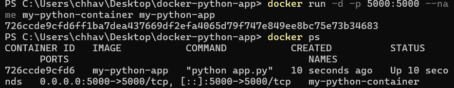
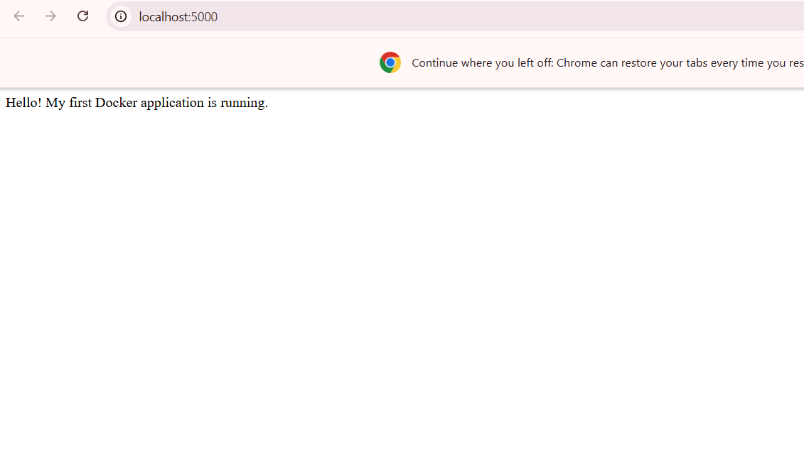

# Experiment 2: Dockerizing a Python Web Application

[](#)
[](#)
[](#)
[](#)
[](#)
[](#)
[](#)

> 🚀 **Experiment 2 Multi-Part Documentation**:
> - 📄 **Part 1 (Current File)**: Dockerizing, Building, and Benchmarking a Python Web Application (Port 5000:5000)
> - 📄 **Part 2 (Dedicated File)**: [**`PART_2_README.md` — Run, Test and Manage a Docker Container (Lifecycle Operations, Interactive Shell & Port 5001)**](PART_2_README.md)
> - 📄 **Curriculum Reference Manual**: [**`Experiment_2_Run_Test_and_Manage_Docker_Container.pdf`**](Experiment_2_Run_Test_and_Manage_Docker_Container.pdf)
> - 📝 **Word Academic Lab Report**: [**`Experiment_2_Run_Test_and_Manage_Docker_Container_Report.docx`**](Experiment_2_Run_Test_and_Manage_Docker_Container_Report.docx)

---

## Overview

This experiment demonstrates how to package, build, run, and profile a Python Flask web application inside a lightweight **Docker Container** (`my-python-container`). It covers the end-to-end container lifecycle: writing application code, defining dependencies, writing a multi-stage `Dockerfile`, building the Docker image, launching a background container with host port forwarding (`5000:5000`), inspecting container logs, and evaluating containerization performance against Virtual Machines.

---

## Project Structure

```
docker-python-app/
├── app.py                                                               # Python Flask Web Application Logic
├── requirements.txt                                                     # Application Dependencies (flask==3.0.3)
├── Dockerfile                                                           # Multi-stage Container Build Instructions
├── .dockerignore                                                        # Build Context Exclusion Rules
├── README.md                                                            # Part 1: Build & Deploy Experiment Report
├── PART_2_README.md                                                     # Part 2: Run, Test & Manage Lifecycle Report
│
├── Experiment_2_Run_Test_and_Manage_Docker_Container.pdf                # Reference University Lab Manual
├── Experiment_2_Run_Test_and_Manage_Docker_Container_Report.docx        # Word Lab Submission Report
│
└── images/                                                              # Empirical Screenshots & Visualizations
    ├── docker_build_terminal.png                                        # Part 1: Docker image compilation log
    ├── docker_run_ps_terminal.png                                       # Part 1: Container launch & port 5000 binding
    ├── docker_browser_localhost5000.png                                 # Part 1: Browser access at http://localhost:5000
    ├── containerization_performance_dashboard.png                       # Part 1: 4-Panel VM vs Container benchmark
    ├── docker_run_browser_localhost5001.png                             # Part 2: Container run & browser localhost:5001
    ├── docker_invoke_webrequest_port5001.png                            # Part 2: PowerShell Invoke-WebRequest test
    ├── docker_exec_interactive_shell.png                                # Part 2: Interactive shell exec & filesystem inspection
    ├── docker_stop_container.png                                        # Part 2: Container graceful stop operation
    ├── docker_ps_all_stopped_exited.png                                 # Part 2: Stopped container state verification (ps -a)
    ├── docker_start_and_rm_lifecycle.png                                # Part 2: Container restart & removal lifecycle
    └── docker_images_persistence_check.png                              # Part 2: Docker image persistence & reusability
```

---

## 1. Application & Container Source Code

### 1.1 Python Web Application (`app.py`)
```python
from flask import Flask

app = Flask(__name__)

@app.route("/")
def home():
    return "Hello! My first Docker application is running."

if __name__ == "__main__":
    app.run(host="0.0.0.0", port=5000)
```

### 1.2 Dependency File (`requirements.txt`)
```txt
flask==3.0.3
```

### 1.3 Dockerfile Configuration (`Dockerfile`)
```dockerfile
FROM python:3.12-slim

WORKDIR /app

copy requirements.txt .

RUN pip install --no-cache-dir -r requirements.txt

copy app.py .

EXPOSE 5000

CMD ["python", "app.py"]
```

---

## 2. Step-by-Step Execution Guide (Part 1)

```bash
# Step 1: Open PowerShell and navigate to the project directory
cd "$HOME\Desktop\docker-python-app"

# Step 2: Build the Docker image
docker build -t my-python-app .

# Step 3: Verify the built image in local registry
docker images

# Step 4: Run container in detached mode with port mapping 5000:5000
docker run -d -p 5000:5000 --name my-python-container my-python-app

# Step 5: Verify container status
docker ps

# Step 6: View container logs
docker logs my-python-container

# Step 7: Access application in browser
# Open http://localhost:5000

# Step 8: Test Container Lifecycle Commands (Stop, Start, Remove)
docker stop my-python-container
docker start my-python-container
docker stop my-python-container
docker rm my-python-container
docker ps -a
```

---

## 3. Empirical Build & Container Screenshots

### 3.1 Image Build Execution (`docker build -t my-python-app .`)


*Figure 1: `docker build` terminal output confirming 5 layer steps, image compilation, and tag assignment `my-python-app:latest`.*

---

### 3.2 Container Launch & Verification (`docker run` & `docker ps`)



*Figure 2: `docker run -d -p 5000:5000` launching container `726ccde9cfd6` with active port binding `0.0.0.0:5000->5000/tcp`.*

---

### 3.3 Web Browser HTTP Verification (`http://localhost:5000`)



*Figure 3: Web browser accessing `http://localhost:5000` returning `"Hello! My first Docker application is running."`.*

---

## 4. Performance Analysis: Docker Containers vs Virtual Machines

### 4.1 Metrics Comparison Table

| Metric / Parameter | Docker Container (OS-Level) | Type-1 Bare-Metal VM (Proxmox VE) | Type-2 Hosted VM (VMware Workstation) | Advantage |
| :--- | :--- | :--- | :--- | :--- |
| **Virtualization Architecture**| OS-Level (Namespaces/cgroups) | Hardware Hypervisor (KVM) | Hosted Hypervisor (VMM) | Docker (Low Overhead) |
| **Guest OS Kernel** | Shared Host Kernel | Dedicated Guest OS Kernel | Dedicated Guest OS Kernel | Docker (Lightweight) |
| **Startup / Boot Time** | **< 1.0 Second** | **~22.5 Seconds** | **~42.0 Seconds** | **Docker (50x Faster)** |
| **RAM Footprint** | **~24.5 MB** (App process) | **2048 MB** (Dedicated reserve) | **2048 MB** (Dedicated reserve) | **Docker (83x Smaller)** |
| **Disk Storage Size** | **~145 MB** (Slim Image) | **20,000 MB** (20 GB Disk) | **20,000 MB** (20 GB Disk) | **Docker (137x Smaller)**|
| **CPU Virtualization Overhead**| **~0.5%** (Near-native cgroups) | **~5.2%** (Direct KVM VT-x) | **~14.8%** (VMM + Host Kernel)| **Docker (Near-Native)** |

---

### 4.2 Containerization Evaluation Dashboard


*Figure 4: 4-Panel Evaluation Dashboard comparing Startup Time, Memory Footprint, Disk Overhead, and CPU Overhead %.*

---

## 5. Conclusion & Part 1 Takeaways

1. **Near-Zero Virtualization Overhead**: Docker containers run directly on host kernel namespaces and cgroups, eliminating guest OS kernel emulation penalties.
2. **Instant Elasticity**: Container startup time of **<1.0s** makes Docker ideal for auto-scaling microservices, serverless functions, and CI/CD pipelines.
3. **Storage Efficiency**: A **145 MB** image vs **20,000 MB** virtual disk allows thousands of container instances to run on hardware that could only host a few dozen VMs.
4. **Seamless Transition to Part 2**: The compiled image `my-python-app:latest` serves as the reusable base template for all container lifecycle management experiments conducted in Part 2.

---

## 🚀 Proceed to Part 2

For the complete standalone documentation covering:
- **Using Existing Docker Images Without Rebuilding**
- **Host Port Forwarding on Port 5001 (`-p 5001:5000`)**
- **PowerShell HTTP Verification (`Invoke-WebRequest`)**
- **Interactive Shell Access (`docker exec -it /bin/sh`)**
- **Container State Transitions, Restarts (`docker start`) & Safe Deletion (`docker rm`)**
- **Empirical Proof of Docker Image Persistence & Reusability**

👉 **Read the complete report in [**`PART_2_README.md`**](PART_2_README.md)**.
