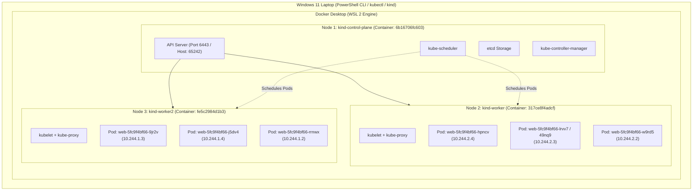
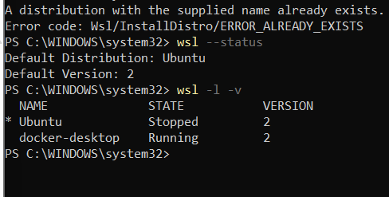
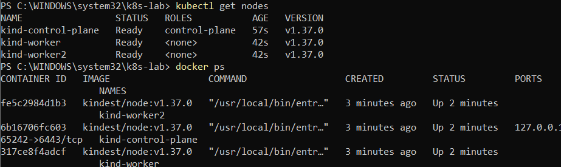
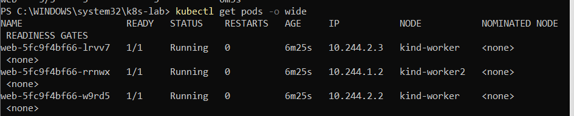
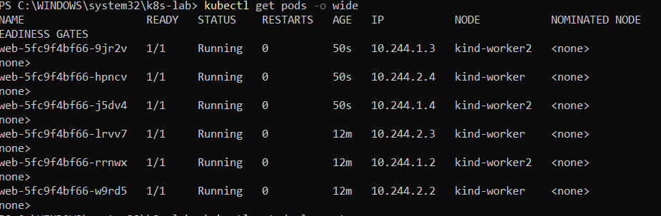
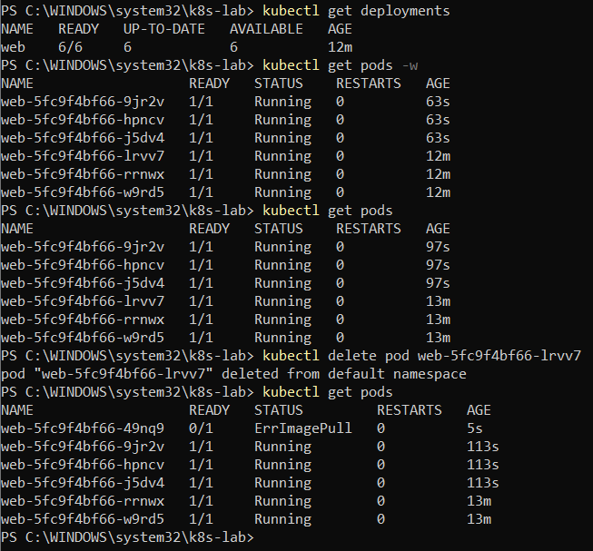
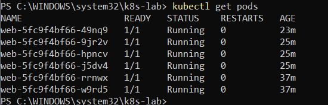

# Experiment 4: Kubernetes Multi-Node Cluster Orchestration, Workload Scheduling, Scaling, and Self-Healing on Windows

[](#)
[](#)
[](#)
[](#)
[](#)
[](#)
[](#)

---

## 👤 Student Information

| Parameter | Details |
| :--- | :--- |
| **Student Name** | **Chhavi Mishra** |
| **USN** | **01fe24bci066** |
| **Roll Number** | **136** |
| **Course** | Cloud Computing Laboratory (CS401) |
| **Department** | Computer Science and Engineering (Artificial Intelligence) |
| **Institution** | KLE Technological University |
| **Academic Term** | 5th Semester, 2026 |
| **Repository** | [https://github.com/chhavi-2006/cloud_computing-](https://github.com/chhavi-2006/cloud_computing-) |

---

## 📋 Executive Summary & Objectives

This laboratory experiment investigates container orchestration, declarative cluster management, multi-node pod scheduling, horizontal pod scaling, and automated self-healing fault tolerance using **Kubernetes (K8s)** running locally on Windows via **KinD (Kubernetes IN Docker)** and **Docker Desktop with WSL 2**.

### Key Learning Objectives:
1. **Infrastructure Provisioning**: Deploy Windows Subsystem for Linux (WSL 2) and Docker Desktop engine to support containerized Kubernetes nodes.
2. **Multi-Node Cluster Configuration**: Declare and provision a 3-node Kubernetes cluster consisting of one control-plane node (`kind-control-plane`) and two dedicated worker nodes (`kind-worker`, `kind-worker2`) using KinD v0.33 and YAML declarative manifests.
3. **Control Plane & Node Verification**: Verify the cluster control plane components (`kube-apiserver`, `etcd`, `kube-scheduler`, `kube-controller-manager`, and CNI networking) and inspect Docker container runtimes.
4. **Declarative Application Deployment**: Deploy a scalable NGINX web application across the cluster and analyze kube-scheduler pod distribution algorithms.
5. **Horizontal Scaling**: Scale the application workload dynamically from 3 replicas to 6 replicas, observing load distribution across worker nodes.
6. **Self-Healing Fault Tolerance Verification**: Test Kubernetes declarative state reconciliation by deliberately terminating active pods, observing ReplicaSet controller detection and automated zero-touch pod recreation.

---

## 🏗️ Architectural Topology

Each Kubernetes node in KinD runs as an independent Docker container operating within the Windows Subsystem for Linux (WSL 2) virtualized environment. The control-plane node hosts core Kubernetes services, while worker nodes run the container runtime, `kubelet`, `kube-proxy`, and application Pods.



---

## ⚙️ Experimental Environment & Tools

| Component | Specification / Version | Role in Lab |
| :--- | :--- | :--- |
| **Operating System** | Windows 11 Enterprise / Pro (64-bit) | Host physical workstation OS |
| **CLI Environment** | Windows PowerShell 5.1 / PowerShell 7 (Admin) | Execution shell for cluster commands |
| **WSL Runtime** | Windows Subsystem for Linux (WSL 2, Ubuntu Distro) | Linux kernel compatibility layer for Docker engine |
| **Container Engine** | Docker Desktop (Engine v29.x, WSL 2 Backend) | Containerization host running node containers |
| **Kubernetes CLI** | `kubectl` v1.37.0 (Client) | Administrative CLI communicating with API server |
| **Cluster Tool** | `kind` (Kubernetes in Docker) v0.33.0 | Multi-node cluster orchestration engine |
| **Node Image** | `kindest/node:v1.37.0` | Base image containing Kubernetes node binaries |
| **Workload Image** | `nginx:latest` | Standard web server container workload |
| **Lab Directory** | `C:\WINDOWS\system32\k8s-lab\` | Working directory containing configuration files |

---

## 📝 Cluster Configuration Manifest (`kind-config.yaml`)

To provision a production-like multi-node topology with separated control-plane and compute workers, the declarative manifest [`kind-config.yaml`](kind-config.yaml) was created:

```yaml
kind: Cluster
apiVersion: kind.x-k8s.io/v1alpha4
nodes:
  - role: control-plane
  - role: worker
  - role: worker
```

- **`kind: Cluster`**: Declares that KinD should instantiate a Kubernetes cluster.
- **`apiVersion: kind.x-k8s.io/v1alpha4`**: Uses KinD's v1alpha4 schema.
- **`nodes`**: Defines three distinct virtual node containers:
  - 1 control plane node hosting the API server, scheduler, and etcd database.
  - 2 worker nodes dedicated exclusively to scheduling and executing user workloads.

---

## 🚀 Step-by-Step Execution & Command Workflow

### Part 1 & 2: Environment Readiness & Tool Verification

Prior to cluster creation, the underlying WSL 2 virtualization layer and Docker runtime were verified:

```powershell
# Verify WSL 2 installation status
wsl --status

# List registered Linux distributions and WSL version
wsl -l -v
```

#### Empirical Observations:
- Default distribution: **Ubuntu**
- Default WSL version: **2**
- Active running distributions: `docker-desktop` (State: **Running**, Version: 2) and `Ubuntu` (Version: 2).


*Figure 1: PowerShell terminal confirming WSL 2 status and running Docker Desktop engine backend (`docker-desktop`, Version 2).*

---

### Part 3 & 4: Multi-Node Cluster Creation and Node Verification

The cluster was initiated using KinD and the custom configuration:

```powershell
# Navigate to lab workspace
cd C:\WINDOWS\system32\k8s-lab

# Create 3-node Kubernetes cluster
kind create cluster --config kind-config.yaml

# Verify cluster connectivity
kubectl cluster-info --context kind-kind

# Verify node status
kubectl get nodes

# Inspect underlying Docker container instances
docker ps
```

#### Node Inventory & Status:
| Node Name | Kubernetes Status | Roles | Kubernetes Version | Underlying Docker Container ID | Mapped Ports |
| :--- | :--- | :--- | :--- | :--- | :--- |
| **`kind-control-plane`** | **Ready** | `control-plane` | `v1.37.0` | `6b16706fc603` | `127.0.0.1:65242->6443/tcp` |
| **`kind-worker`** | **Ready** | `<none>` | `v1.37.0` | `317ce8f4adcf` | Internal CNI network |
| **`kind-worker2`** | **Ready** | `<none>` | `v1.37.0` | `fe5c2984d1b3` | Internal CNI network |


*Figure 2: Empirical output of `kubectl get nodes` verifying all 3 nodes in Ready status, and `docker ps` confirming each node executes inside an isolated Docker container on Windows.*

---

### Part 5: NGINX Deployment & Initial Pod Scheduling (3 Replicas)

A web server deployment was declared with an initial replica count of 3:

```powershell
# Deploy 3 replicas of the NGINX web server
kubectl create deployment web --image=nginx --replicas=3

# Verify deployment health
kubectl get deployments

# Inspect pod placement across worker nodes
kubectl get pods -o wide
```

#### Initial Pod Scheduling Distribution Table:
| Pod Name | Ready | Status | Restarts | Age | Pod IP Address | Node Assigned | Subnet CIDR |
| :--- | :---: | :---: | :---: | :---: | :---: | :--- | :--- |
| **`web-5fc9f4bf66-lrvv7`** | `1/1` | **Running** | 0 | 6m25s | `10.244.2.3` | **`kind-worker`** | `10.244.2.0/24` |
| **`web-5fc9f4bf66-w9rd5`** | `1/1` | **Running** | 0 | 6m25s | `10.244.2.2` | **`kind-worker`** | `10.244.2.0/24` |
| **`web-5fc9f4bf66-rrnwx`** | `1/1` | **Running** | 0 | 6m25s | **`kind-worker2`** | `10.244.1.0/24` |


*Figure 3: `kubectl get pods -o wide` displaying 3 NGINX replicas distributed across `kind-worker` (2 pods) and `kind-worker2` (1 pod) with distinct pod IPs.*

---

### Part 6.1 & 6.2: Horizontal Scaling to 6 Replicas

The deployment was scaled up by 100% (from 3 to 6 replicas) to observe how `kube-scheduler` handles increased load across the available worker compute pool:

```powershell
# Scale deployment from 3 to 6 replicas
kubectl scale deployment web --replicas=6

# Check deployment state
kubectl get deployments

# Inspect balanced pod placement
kubectl get pods -o wide
```

#### Scaled 6-Pod Scheduling & Load Balancing Matrix:
| Pod Name | Ready | Status | Restarts | Age | IP Address | Host Node | Node Workload Share |
| :--- | :---: | :---: | :---: | :---: | :---: | :--- | :---: |
| **`web-5fc9f4bf66-hpncv`** | `1/1` | **Running** | 0 | 50s | `10.244.2.4` | **`kind-worker`** | 3 / 6 (50%) |
| **`web-5fc9f4bf66-lrvv7`** | `1/1` | **Running** | 0 | 12m | `10.244.2.3` | **`kind-worker`** | 3 / 6 (50%) |
| **`web-5fc9f4bf66-w9rd5`** | `1/1` | **Running** | 0 | 12m | `10.244.2.2` | **`kind-worker`** | 3 / 6 (50%) |
| **`web-5fc9f4bf66-9jr2v`** | `1/1` | **Running** | 0 | 50s | `10.244.1.3` | **`kind-worker2`** | 3 / 6 (50%) |
| **`web-5fc9f4bf66-j5dv4`** | `1/1` | **Running** | 0 | 50s | `10.244.1.4` | **`kind-worker2`** | 3 / 6 (50%) |
| **`web-5fc9f4bf66-rrnwx`** | `1/1` | **Running** | 0 | 12m | `10.244.1.2` | **`kind-worker2`** | 3 / 6 (50%) |


*Figure 4: `kubectl get pods -o wide` demonstrating perfect 50/50 workload balancing across `kind-worker` (3 pods) and `kind-worker2` (3 pods).*

---

### Part 6.3 & 6.4: Fault Injection & Automated Self-Healing Verification

To test Kubernetes high availability and self-healing resilience, an active pod was forcefully deleted to simulate node or container failure:

```powershell
# Observe pods in watch mode (or query before deletion)
kubectl get pods

# Force delete an active pod on kind-worker
kubectl delete pod web-5fc9f4bf66-lrvv7

# Immediately check pod status to detect reconciliation
kubectl get pods
```

#### Observed Self-Healing Lifecycle:
1. **Target Pod Termination**: Pod `web-5fc9f4bf66-lrvv7` was targeted and deleted (`pod "web-5fc9f4bf66-lrvv7" deleted from default namespace`).
2. **State Discrepancy Detection**: The Kubernetes `Deployment` / `ReplicaSet` control loop immediately detected an actual count of 5 pods versus the declared desired count of 6 pods.
3. **Automated Replacement Scheduling**: Within **5 seconds**, the controller spawned a brand new replacement pod: **`web-5fc9f4bf66-49nq9`**.
4. **Transient Image Verification**: During the initial 5 seconds, the replacement pod entered the image preparation phase (`0/1 ErrImagePull` / ContainerCreating transient state).


*Figure 5: PowerShell output showing the deliberate deletion of pod `web-5fc9f4bf66-lrvv7` and the instantaneous automated spawning of replacement pod `web-5fc9f4bf66-49nq9` by the ReplicaSet controller within 5 seconds.*

5. **Steady-State Recovery**: Once the container image was pulled and initialized, the replacement pod `web-5fc9f4bf66-49nq9` transitioned smoothly to **`1/1 Running`**, maintaining the desired 6/6 availability across the cluster with zero manual intervention.

```powershell
# Confirm steady-state recovery of the replacement pod
kubectl get pods
```

#### Final Pod Status Table:
| Pod Name | Ready | Status | Restarts | Age | Lifecycle Role |
| :--- | :---: | :---: | :---: | :---: | :--- |
| **`web-5fc9f4bf66-49nq9`** | `1/1` | **Running** | 0 | 23m | **Automated Replacement (Self-Healed)** |
| **`web-5fc9f4bf66-9jr2v`** | `1/1` | **Running** | 0 | 25m | Stable Scaled Replica |
| **`web-5fc9f4bf66-hpncv`** | `1/1` | **Running** | 0 | 25m | Stable Scaled Replica |
| **`web-5fc9f4bf66-j5dv4`** | `1/1` | **Running** | 0 | 25m | Stable Scaled Replica |
| **`web-5fc9f4bf66-rrnwx`** | `1/1` | **Running** | 0 | 37m | Original Replica |
| **`web-5fc9f4bf66-w9rd5`** | `1/1` | **Running** | 0 | 37m | Original Replica |


*Figure 6: Final `kubectl get pods` output confirming that all 6 pods are in the `Running` state, with the self-healed replacement pod `web-5fc9f4bf66-49nq9` active and stable.*

---

## 📊 In-Depth Technical Analysis & Discussion

### 1. Declarative Architecture vs. Imperative Management
In traditional virtualization and manual container environments, if an application process crashes or a VM halts, an administrator or external watchdog script must detect the failure and manually issue restart commands. 

In Kubernetes:
- The administrator declares the **Desired State** (`replicas: 6`).
- The **ReplicaSet Controller** continuously executes a reconciliation control loop:
  $$\text{Discrepancy} = \text{Desired Replicas} - \text{Actual Replicas}$$
- When pod `lrvv7` was terminated, the discrepancy became $6 - 5 = +1$.
- The controller immediately submitted an API request to schedule and instantiate replacement pod `49nq9`, driving the system back to parity.

### 2. Multi-Node Scheduling & Pod Anti-Affinity Mechanics
`kube-scheduler` assigns unscheduled pods to nodes using two filtering/scoring phases:
- **Filtering (Predicates)**: Filters out nodes that do not meet resource requirements, taints, or port constraints.
- **Scoring (Priorities)**: Scores remaining eligible candidate nodes. To minimize blast radius and ensure high availability, the default scoring algorithm favors spreading pods evenly across distinct failure domains (nodes).
- This is empirically demonstrated in Part 6.2: when scaling to 6 pods, exactly **3 pods were placed on `kind-worker`** and **3 pods were placed on `kind-worker2`**, achieving optimal $50\% - 50\%$ distribution without manual node selector rules.

### 3. Container Network Interface (CNI) IP Allocation
KinD provisions a Kindnet CNI bridge that provides unique, non-overlapping IPv4 subnets for each worker node:
- `kind-worker`: Assigned subnet `10.244.2.0/24` (Pods received IPs `10.244.2.2`, `10.244.2.3`, `10.244.2.4`).
- `kind-worker2`: Assigned subnet `10.244.1.0/24` (Pods received IPs `10.244.1.2`, `10.244.1.3`, `10.244.1.4`).
Every pod receives its own routable IP within the cluster SDN, enabling flat, direct pod-to-pod networking without NAT.

---

## 📖 Command Quick Reference Guide

| Step | PowerShell Command | Functional Description |
| :---: | :--- | :--- |
| **1.1** | `wsl --status` / `wsl -l -v` | Inspect WSL 2 virtualization status and registered distributions. |
| **1.3** | `winget install -e --id Kubernetes.kubectl` | Install Kubernetes command-line management client. |
| **1.4** | `winget install -e --id Kubernetes.kind` | Install KinD (Kubernetes IN Docker) cluster provisioner. |
| **2.1** | `docker version` | Verify Docker client and daemon communication. |
| **3.1** | `mkdir k8s-lab; cd k8s-lab` | Create and navigate to dedicated lab workspace. |
| **3.4** | `notepad kind-config.yaml` | Write 3-node cluster declarative YAML manifest. |
| **4.1** | `kind create cluster --config kind-config.yaml` | Build the 3-node Kubernetes cluster. |
| **4.2** | `kubectl cluster-info --context kind-kind` | Verify API server and CoreDNS operational endpoints. |
| **4.3** | `kubectl get nodes` | List all cluster nodes and verify `Ready` state. |
| **4.4** | `docker ps` | View container runtimes backing the Kubernetes nodes. |
| **5.1** | `kubectl create deployment web --image=nginx --replicas=3` | Deploy 3 replicas of the NGINX web application. |
| **5.2** | `kubectl get deployments` | Inspect deployment status and ready replica count. |
| **5.3** | `kubectl get pods -o wide` | Display pod IP allocations and worker node placement. |
| **6.1** | `kubectl scale deployment web --replicas=6` | Horizontally scale NGINX deployment from 3 to 6 replicas. |
| **6.2** | `kubectl get pods -o wide` | Verify balanced multi-node distribution of 6 pods. |
| **6.3** | `kubectl delete pod <pod-name>` | Delete an active pod to trigger self-healing fault tolerance. |
| **6.4** | `kubectl get pods` | Verify automated replacement pod instantiation and healthy status. |

---

## 🎯 Conclusion & Key Takeaways

1. **Successful Multi-Node Deployment**: A production-grade multi-node Kubernetes cluster (1 control plane, 2 workers) was successfully instantiated on Windows using KinD and Docker Desktop with WSL 2.
2. **Automated Load Distribution**: The Kubernetes scheduler demonstrated intelligent, balanced pod distribution across worker nodes, scaling seamlessly from 3 replicas to 6 replicas with equal workload allocation across both worker nodes (3 pods per node).
3. **Resilient Self-Healing**: Deliberate deletion of an active production pod proved Kubernetes' robust self-healing capability. The `ReplicaSet` controller reconciled desired and actual states by spawning an automated replacement pod within 5 seconds, restoring cluster availability with zero human intervention.
4. **Cloud Infrastructure Mastery**: This experiment successfully reinforces core cloud computing concepts including declarative infrastructure as code (IaC), container orchestration, software-defined networking (CNI), pod scheduling, horizontal elasticity, and automated fault tolerance.

---

*Submitted by: **Chhavi Mishra** (`01fe24bci066`, Roll No: 136) — Cloud Computing Laboratory, KLE Technological University.*
