# Experiment 5 — Part 2: Deploy Multiple Docker Containers Using HashiCorp Terraform

[](#)
[](#)
[](#)
[](#)
[](#)
[](#)

---

## 📌 Navigation & Laboratory Series
- 📖 [**`Part 1: Local File Provisioning, Validation, Drift & Destruction`**](README.md)
- 📖 [**`Part 2: Multiple Docker Container Deployment with Docker Provider`**](PART_2_README.md) *(Current Document)*
- 📄 [**`Official Reference Manual (PDF)`**](Terraform_Experiment_1_Multiple_Docker_Containers_Large_Font.pdf)
- 📑 [**`Formal Word Laboratory Report (.docx)`**](Experiment_5_Part_2_Multiple_Docker_Containers_Report.docx)

---

## 1. Executive Summary & Aim

### 1.1 Aim
To provision, deploy, manage, and verify multiple heterogeneous Docker containers using HashiCorp Terraform by defining infrastructure resources through declarative Infrastructure as Code (IaC), leveraging the `kreuzwerker/docker` provider plugin on Windows PowerShell.

### 1.2 Laboratory Objectives
1. **Infrastructure as Code (IaC) Mastery**: Configure Terraform to communicate with the local Docker daemon via the `kreuzwerker/docker` provider (`~> 3.0`).
2. **Declarative Multi-Service Definition**: Declare multi-tier container resources comprising an **NGINX Alpine Web Server** and a **Python 3.12 HTTP Server** inside a single unified manifest (`main.tf`).
3. **Implicit Dependency Graph Execution**: Demonstrate how Terraform inspects interpolations (e.g., `image = docker_image.nginx.image_id`) to automatically build a Directed Acyclic Graph (DAG) ensuring images are fetched before container instantiation.
4. **Network & Port Mapping Orchestration**: Map container internal ports (NGINX `80`, Python `8000`) to distinct host interfaces (`0.0.0.0:8082` and `0.0.0.0:8081`).
5. **State Tracking & Convergence**: Validate local state tracking (`terraform.tfstate`), inspect resource IDs and cryptographic hashes, and observe automated convergence during updates.
6. **Empirical Verification**: Verify live web endpoints using web browsers and inspect runtime container lifecycles via the Docker CLI (`docker ps`).

---

## 2. System Architecture & Topology

The deployment architecture consists of Terraform acting as the orchestration client, communicating directly with Docker Engine via the Windows local named pipe (`npipe:////./pipe/docker_engine`).

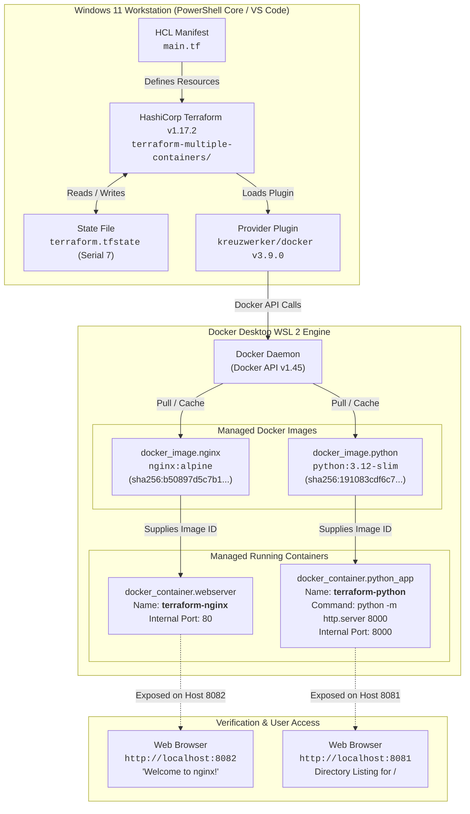

---

## 3. System Environment & Specifications

| Component | Specification / Version | Purpose |
| :--- | :--- | :--- |
| **Operating System** | Microsoft Windows 11 Enterprise (64-bit) | Workstation Host Environment |
| **Shell Environment** | Windows PowerShell 5.1 / PowerShell Core | Command Execution & Terminal Testing |
| **IaC Orchestrator** | **HashiCorp Terraform v1.17.2** (`windows_amd64`) | Declarative Infrastructure Lifecycle Engine |
| **Terraform Provider**| **`kreuzwerker/docker` v3.9.0** (`windows_amd64`) | Terraform Docker Engine Driver Plugin |
| **Container Engine** | **Docker Desktop v28.0+ / Docker CE (WSL 2)** | Container Runtime & Virtualization Layer |
| **Web Server App** | `nginx:alpine` (Host Port `8082` -> Container `80`) | Lightweight HTTP Web Server |
| **Python App** | `python:3.12-slim` (Host Port `8081` -> Container `8000`) | Standard Library HTTP File Server |
| **State File** | `terraform.tfstate` (Lineage `013ad275...`, Serial `7`) | Idempotent Resource Tracking Database |

---

## 4. Declarative Infrastructure Manifest (`main.tf`)

The infrastructure is written entirely in HashiCorp Configuration Language (HCL) within [`main.tf`](part2-multiple-containers/main.tf):

```hcl
terraform {
  required_providers {
    docker = {
      source  = "kreuzwerker/docker"
      version = "~> 3.0"
    }
  }
}

provider "docker" {}

# 1. Nginx Docker image resource
resource "docker_image" "nginx" {
  name = "nginx:alpine"
}

# 2. Python Docker image resource
resource "docker_image" "python" {
  name = "python:3.12-slim"
}

# 3. Nginx container resource
resource "docker_container" "webserver" {
  name  = "terraform-nginx"
  image = docker_image.nginx.image_id

  ports {
    internal = 80
    external = 8082
  }
}

# 4. Python HTTP server container resource
resource "docker_container" "python_app" {
  name  = "terraform-python"
  image = docker_image.python.image_id

  command = [
    "python",
    "-m",
    "http.server",
    "8000"
  ]

  ports {
    internal = 8000
    external = 8081
  }
}
```

### Architectural Manifest Highlights
1. **Provider Declaration**: Specifies `kreuzwerker/docker` version constraint `~> 3.0` which installed `v3.9.0`.
2. **Implicit Dependency Resolution**: The parameter `image = docker_image.nginx.image_id` causes Terraform to construct an implicit dependency edge: `docker_container.webserver` depends on `docker_image.nginx`. Terraform guarantees that the image is pulled before container creation begins.
3. **Execution Command Override**: The `command` attribute overrides the default container entrypoint/CMD, launching Python's built-in non-blocking asynchronous HTTP server bound to port 8000.
4. **Port Forwarding**: Declaratively bridges container ports `80` and `8000` to non-conflicting workstation ports `8082` and `8081`.

---

## 5. Step-by-Step Implementation & Empirical Execution

### Step 1: Pre-flight Verification & Environment Setup
Verify Docker daemon connectivity and Terraform binary availability:
```powershell
docker --version
docker ps
terraform --version
```
*Result*: Docker Desktop was confirmed active and running on WSL 2; Terraform `v1.17.2` was confirmed in system PATH.

### Step 2: Working Directory Setup & Provider Initialization (`terraform init`)
Initialize the project workspace in `C:\terraform-multiple-containers`:
```powershell
PS C:\terraform-multiple-containers> terraform init
```
**Output Highlights**:
- Finding `kreuzwerker/docker` versions matching `~> 3.0`...
- Installing `kreuzwerker/docker v3.9.0`...
- Created `.terraform.lock.hcl` to lock the exact provider binary signature (`key ID 0DCE698927DAF8EC`).
- `Terraform has been successfully initialized!`

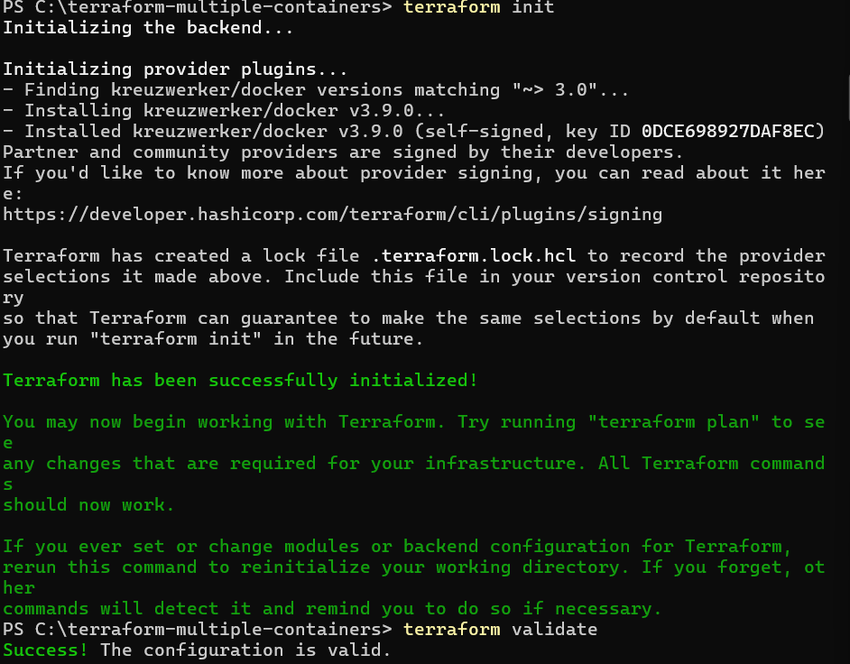
*Figure 1: `terraform init` and `terraform validate` terminal outputs.*

### Step 3: Manifest Syntax & Structural Validation (`terraform validate`)
```powershell
PS C:\terraform-multiple-containers> terraform validate
Success! The configuration is valid.
```
The static parser verified all block types, attribute schemas, and type contracts.

### Step 4: Speculative Execution Planning (`terraform plan`)
Terraform compared the declarative manifest against the current state of Docker Engine:
```powershell
PS C:\terraform-multiple-containers> terraform plan
```
**Plan Highlights**:
- `# docker_image.nginx will be created` (image: `nginx:alpine`)
- `# docker_image.python will be created` (image: `python:3.12-slim`)
- `# docker_container.webserver will be created` (name: `terraform-nginx`, ports: external `8082`, internal `80`)
- `# docker_container.python_app will be created` (name: `terraform-python`, ports: external `8081`, internal `8000`, command: `["python", "-m", "http.server", "8000"]`)
- **Plan Summary**: `4 to add, 0 to change, 0 to destroy.`

<table align="center">
  <tr>
    <td align="center">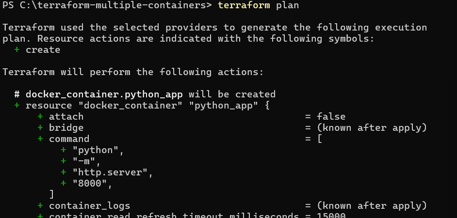<br/><b>Figure 2:</b> Python Container Plan</td>
    <td align="center">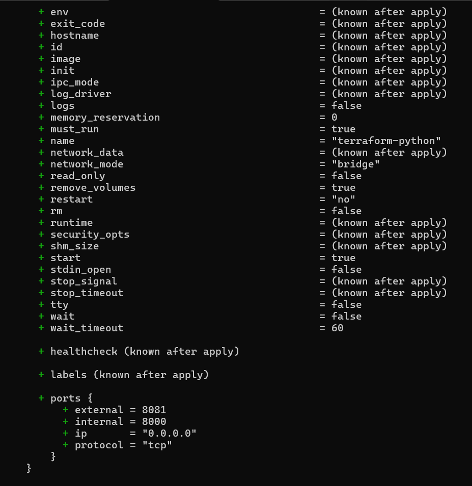<br/><b>Figure 3:</b> Python Port Mappings</td>
  </tr>
  <tr>
    <td align="center">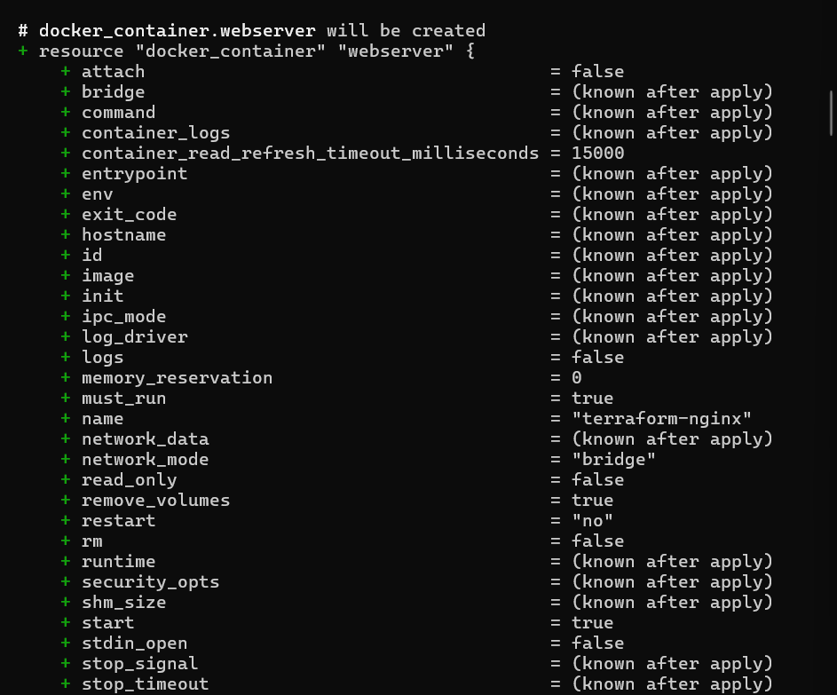<br/><b>Figure 4:</b> Nginx Container Plan</td>
    <td align="center">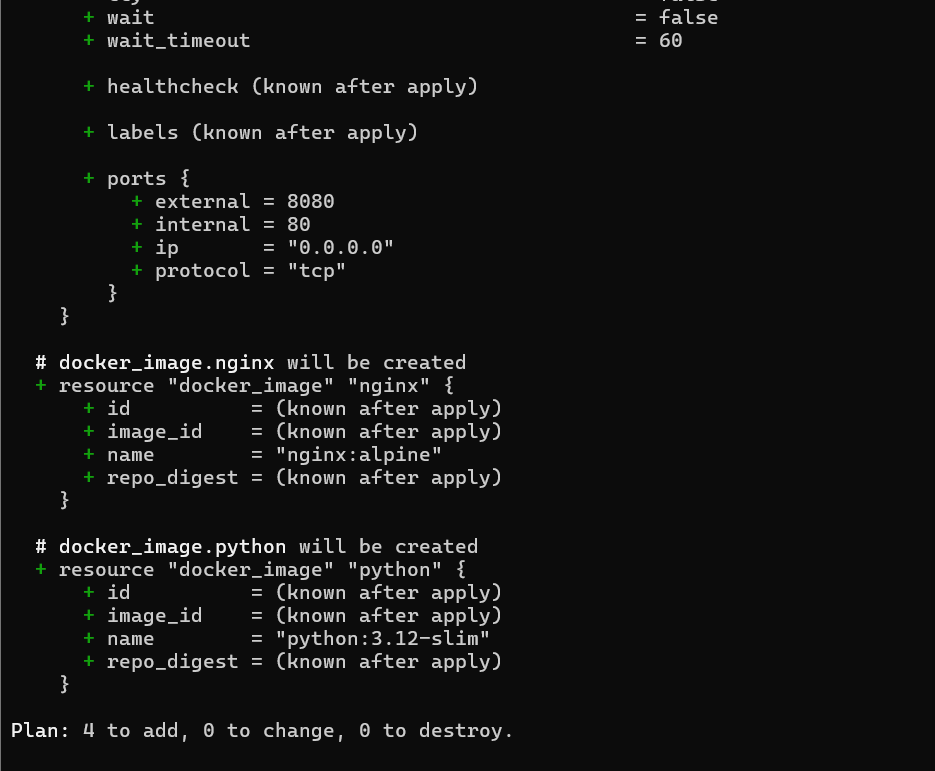<br/><b>Figure 5:</b> Image Plans & 4-Resource Summary</td>
  </tr>
</table>

### Step 5: Infrastructure Deployment (`terraform apply`)
Apply the execution plan to provision images and containers:
```powershell
PS C:\terraform-multiple-containers> terraform apply
```
Terraform refreshed state, presented the execution plan, and prompted for confirmation (`Enter a value: yes`).

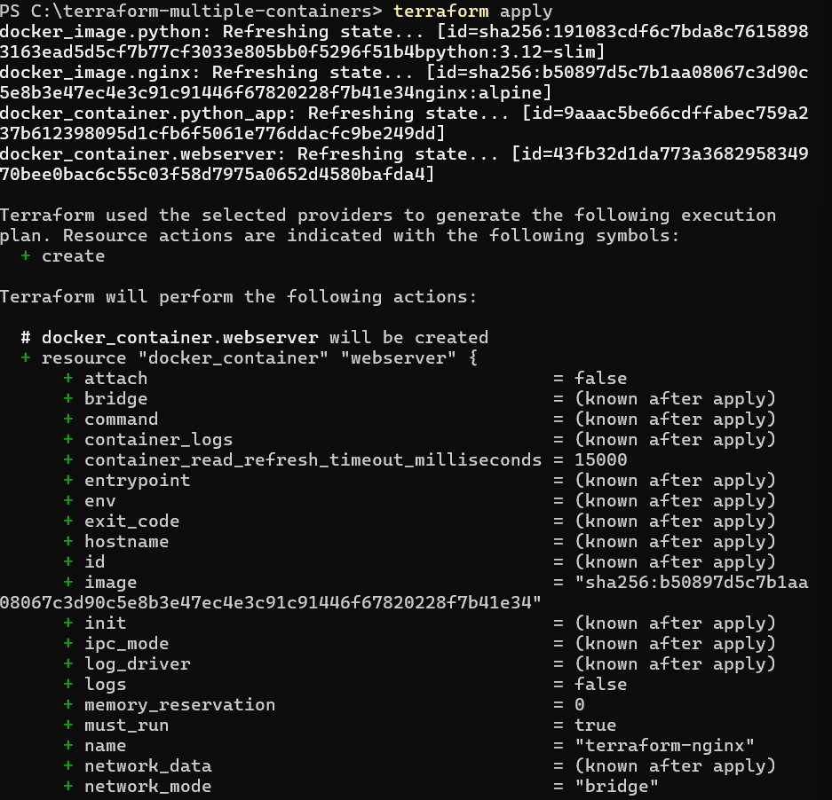
*Figure 6: Terraform state refresh inspecting existing infrastructure.*

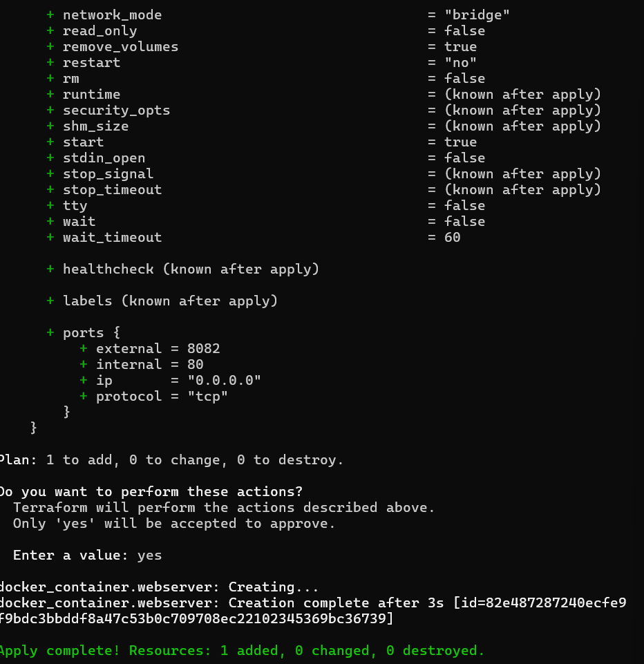
*Figure 7: Creation of `docker_container.webserver` in 3s (`id=82e487287240...`) and `Apply complete!`.*

### Step 6: Docker Engine Runtime Verification (`docker ps`)
Verify running containers through the Docker CLI:
```powershell
PS C:\terraform-multiple-containers> docker ps
```

```text
CONTAINER ID   IMAGE          COMMAND                  CREATED         STATUS         PORTS                  NAMES
82e487287240   b50897d5c7b1   "/docker-entrypoint..."  9 seconds ago   Up 8 seconds   0.0.0.0:8082->80/tcp   terraform-nginx
9aaac5be66cd   191083cdf6c7   "python -m http.serv..." 7 minutes ago   Up 7 minutes   0.0.0.0:8081->8000/tcp terraform-python
```

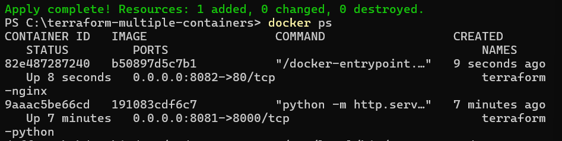
*Figure 8: Docker process table confirming `terraform-nginx` and `terraform-python` running healthy.*

### Step 7: Live Web Browser Endpoint Verification
Open web browser tabs to verify that both applications respond independently:
1. **Nginx Web Server (`http://localhost:8082`)**: Returns the official `"Welcome to nginx!"` landing page.
2. **Python HTTP Server (`http://localhost:8081`)**: Returns the directory listing of the container's root filesystem (`/`), displaying `.dockerenv`, `bin`, `boot`, `dev`, `etc`, `home`, `lib`, `proc`, `root`, `sys`, `tmp`, `usr`, `var`.

<table align="center">
  <tr>
    <td align="center">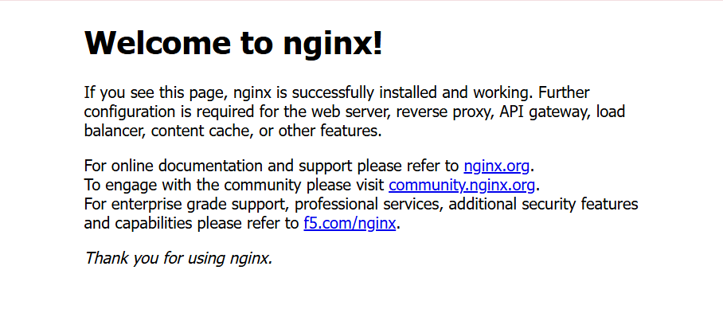<br/><b>Figure 9:</b> Nginx Server on <code>http://localhost:8082</code></td>
    <td align="center">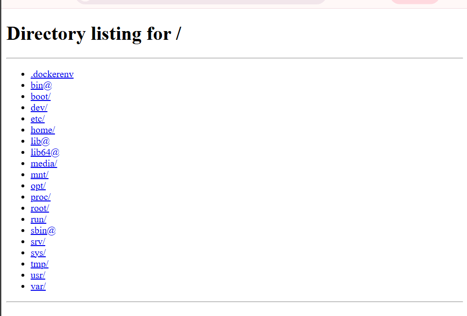<br/><b>Figure 10:</b> Python HTTP Server on <code>http://localhost:8081</code></td>
  </tr>
</table>

---

## 6. Deep-Dive: Terraform State Analysis (`terraform.tfstate`)

The real-world infrastructure state is recorded in `terraform.tfstate`:
- **Terraform Engine Version**: `1.17.2`
- **Serial**: `7`
- **Lineage GUID**: `013ad275-2a18-472c-50ac-76dc82d7a0f2`

### Managed Resources Breakdown:
```json
{
  "version": 4,
  "terraform_version": "1.17.2",
  "serial": 7,
  "lineage": "013ad275-2a18-472c-50ac-76dc82d7a0f2",
  "resources": [
    {
      "mode": "managed",
      "type": "docker_image",
      "name": "nginx",
      "provider": "provider[\"registry.terraform.io/kreuzwerker/docker\"]",
      "instances": [
        {
          "schema_version": 0,
          "attributes": {
            "id": "sha256:b50897d5c7b1aa08067c3d90c5e8b3e47ec4e3c91c91446f67820228f7b41e34",
            "name": "nginx:alpine",
            "image_id": "sha256:b50897d5c7b1aa08067c3d90c5e8b3e47ec4e3c91c91446f67820228f7b41e34"
          }
        }
      ]
    },
    {
      "mode": "managed",
      "type": "docker_image",
      "name": "python",
      "provider": "provider[\"registry.terraform.io/kreuzwerker/docker\"]",
      "instances": [
        {
          "schema_version": 0,
          "attributes": {
            "id": "sha256:191083cdf6c7bda8c76158983163ead5d5cf7b77cf3033e805bb0f5296f51b4b",
            "name": "python:3.12-slim",
            "image_id": "sha256:191083cdf6c7bda8c76158983163ead5d5cf7b77cf3033e805bb0f5296f51b4b"
          }
        }
      ]
    },
    {
      "mode": "managed",
      "type": "docker_container",
      "name": "webserver",
      "provider": "provider[\"registry.terraform.io/kreuzwerker/docker\"]",
      "instances": [
        {
          "schema_version": 2,
          "attributes": {
            "id": "82e487287240ecfe9f9bdc3bbddf8a47c53b0c709708ec22102345369bc36739",
            "name": "terraform-nginx",
            "image": "sha256:b50897d5c7b1aa08067c3d90c5e8b3e47ec4e3c91c91446f67820228f7b41e34",
            "network_mode": "bridge",
            "ports": [
              {
                "external": 8082,
                "internal": 80,
                "ip": "0.0.0.0",
                "protocol": "tcp"
              }
            ]
          }
        }
      ]
    },
    {
      "mode": "managed",
      "type": "docker_container",
      "name": "python_app",
      "provider": "provider[\"registry.terraform.io/kreuzwerker/docker\"]",
      "instances": [
        {
          "schema_version": 2,
          "attributes": {
            "id": "9aaac5be66cdffabec759a237b612398095d1cfb6f5061e776ddacfc9be249dd",
            "name": "terraform-python",
            "image": "sha256:191083cdf6c7bda8c76158983163ead5d5cf7b77cf3033e805bb0f5296f51b4b",
            "command": ["python", "-m", "http.server", "8000"],
            "network_mode": "bridge",
            "ports": [
              {
                "external": 8081,
                "internal": 8000,
                "ip": "0.0.0.0",
                "protocol": "tcp"
              }
            ]
          }
        }
      ]
    }
  ]
}
```

---

## 7. Comparative Technical Analysis: IaC vs Container Tooling

| Capability / Dimension | HashiCorp Terraform | Docker Compose | Kubernetes (`kubectl` / KinD) |
| :--- | :--- | :--- | :--- |
| **Primary Scope** | Multi-Cloud & Hybrid Infrastructure Provisioning | Single-Host Container Composition | Distributed Multi-Node Container Orchestration |
| **Target Entities** | Virtual Networks, Cloud APIs, Containers, DNS, VMs | Containers, Local Volumes, Local Networks | Pods, Deployments, ReplicaSets, Services, Ingress |
| **State Management** | Centralized / Local State File (`terraform.tfstate`) | Implicit in Docker Daemon inspection | Distributed Consensus via `etcd` Key-Value Store |
| **Drift Detection** | **Native** (`terraform plan` / `refresh`) | None (recreates on up/down) | **Continuous Active Reconciliation Loop** |
| **Execution Model** | Plan -> Preview -> Approval -> Apply | Immediate `docker compose up` | Declarative Manifest Submission (`kubectl apply`) |
| **Dependency Model** | Explicit DAG resolution via HCL references | `depends_on` service definitions | Decoupled DNS Service Discovery & Health Probes |
| **Teardown & Lifecycle**| Safe reverse-DAG destruction (`terraform destroy`)| Immediate tear-down (`docker compose down`) | Cascading object deletion (`kubectl delete`) |

---


---

## 9. Conclusion & Key Takeaways

1. **Declarative Multi-Container Automation**: Successfully orchestrated multiple isolated Docker containers (`terraform-nginx` and `terraform-python`) running heterogeneous workloads using pure Infrastructure as Code (IaC).
2. **Deterministic Resource Dependency Handling**: Confirmed that Terraform's graph-based DAG engine reliably manages image downloads prior to container spawning without requiring manual shell scripting or sleep timers.
3. **Robust Isolation & Port Forwarding**: Verified that multiple web servers can run concurrently on isolated bridge networks, correctly exposing ports `8082` and `8081` for external client consumption.
4. **State-Driven Consistency**: Demonstrated the power of Terraform state tracking (`serial: 7`, `lineage: 013ad275...`), providing full auditability and preventing configuration drift.

---
**Prepared by:** Chhavi Mishra (`01fe24bci066`, Roll No: `136`)  
**Department:** Department of Computer Science & Engineering (Artificial Intelligence)  
**Institution:** KLE Technological University, Hubballi  
