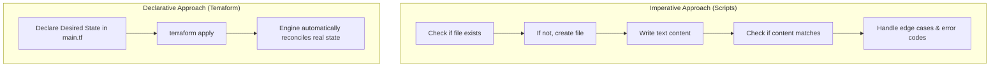
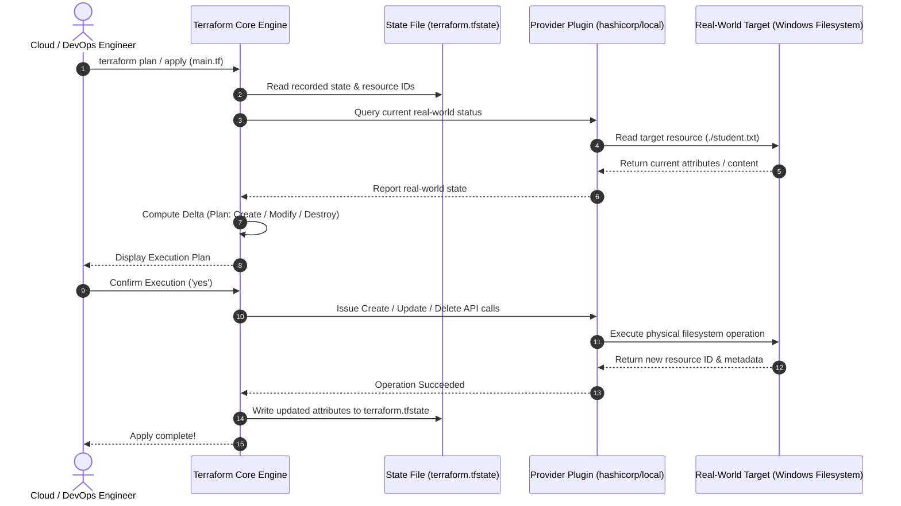
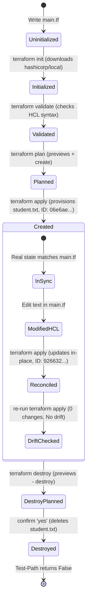
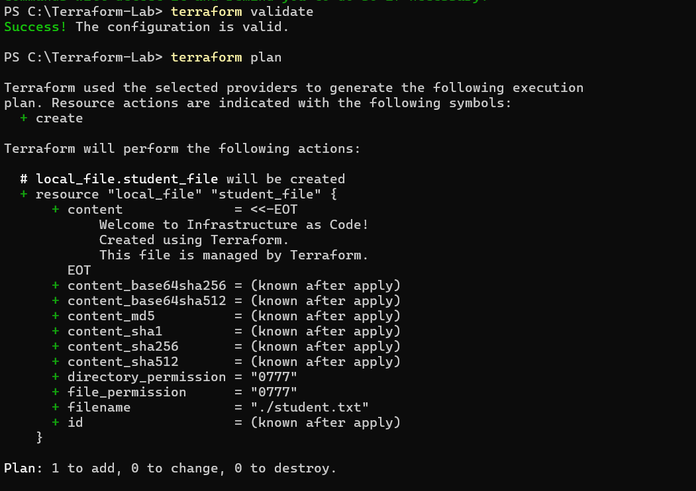
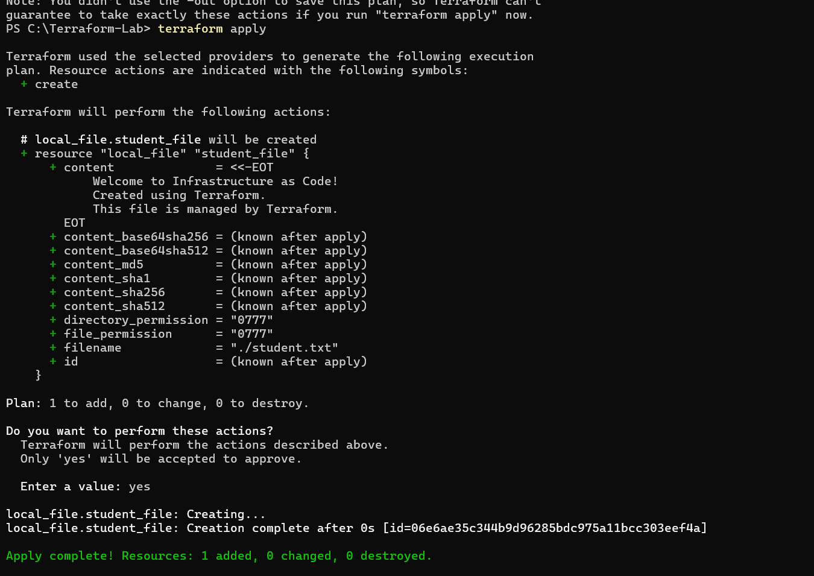
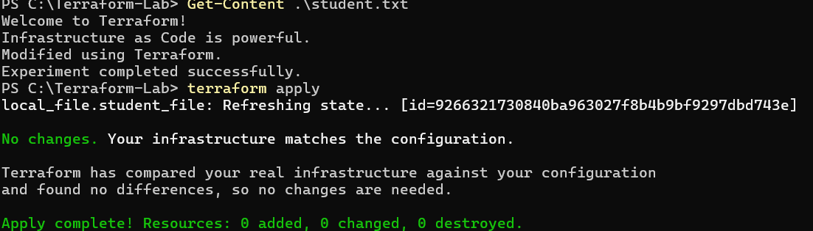
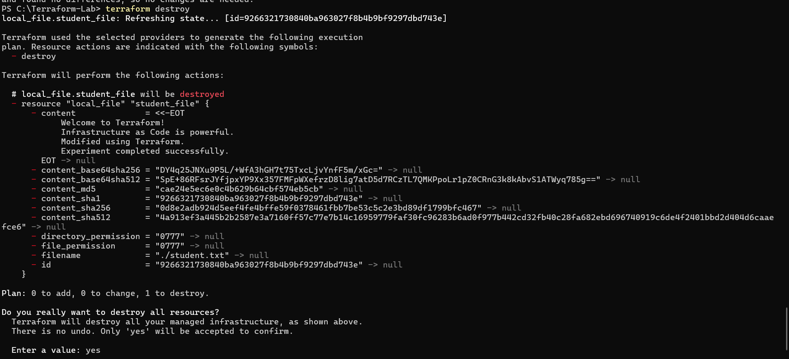
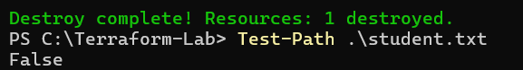

# Experiment 5: Infrastructure as Code (IaC) with HashiCorp Terraform on Windows

[](#)
[](#)
[](#)
[](#)
[](#)
[](#)
[](#)
[](#)

---

## 📑 Laboratory Manuals & Reference Links

- 📖 **Part 1 (Current Document)**: [**`README.md (Single Local File Lifecycle)`**](README.md)
- 📖 **Part 2 (Multiple Docker Containers)**: [**`PART_2_README.md (NGINX & Python with Docker Provider)`**](PART_2_README.md)
- 📄 **Part 1 Official Lab Guide**: [**`terraform_iac_experiment_windows_powerShell.docx`**](terraform_iac_experiment_windows_powerShell.docx)
- 📄 **Part 2 Official Lab Guide (PDF)**: [**`Terraform_Experiment_1_Multiple_Docker_Containers_Large_Font.pdf`**](Terraform_Experiment_1_Multiple_Docker_Containers_Large_Font.pdf)
- 📝 **Part 1 Word Report**: [**`Experiment_5_Terraform_IaC_Report.docx`**](Experiment_5_Terraform_IaC_Report.docx)
- 📝 **Part 2 Word Report**: [**`Experiment_5_Part_2_Multiple_Docker_Containers_Report.docx`**](Experiment_5_Part_2_Multiple_Docker_Containers_Report.docx)
- 🏠 **Main Course Hub**: [**`../README.md`**](../README.md)

---

## 📖 Executive Summary

This laboratory series demonstrates the core principles of **Infrastructure as Code (IaC)** on Windows 11 using **HashiCorp Terraform v1.17.2** across two complementary practical tiers:
1. **Part 1: Local Resource Lifecycle (`local_file`)**: Pure local resource automation, state tracking, drift convergence, and de-provisioning.
2. **Part 2: Multiple Container Deployment (`kreuzwerker/docker`)**: Orchestrating real-world multi-container services (NGINX Web Server on port `8082` and Python HTTP Server on port `8081`) via Docker Engine (detailed in [**`PART_2_README.md`**](PART_2_README.md)).

---

## 📂 Project Directory Structure

```
terraform-iac/
│
├── README.md                                                            # Part 1: Local File IaC Documentation
├── PART_2_README.md                                                     # Part 2: Multiple Docker Containers Documentation
├── main.tf                                                              # Part 1: Terraform Configuration Manifest
├── .terraform.lock.hcl                                                  # Part 1: Provider Dependency Lock File (hashicorp/local)
├── terraform_iac_experiment_windows_powerShell.docx                     # Part 1: Reference Lab Manual Guide
├── Experiment_5_Terraform_IaC_Report.docx                               # Part 1: Academic Word Lab Report
│
├── part2-multiple-containers/                                           # Part 2 Configuration Workspace
│   ├── main.tf                                                          # Part 2: Docker Provider Manifest (Nginx + Python)
│   └── .terraform.lock.hcl                                              # Part 2: Provider Dependency Lock File (kreuzwerker/docker)
├── Terraform_Experiment_1_Multiple_Docker_Containers_Large_Font.pdf     # Part 2: Reference Manual (PDF)
├── Experiment_5_Part_2_Multiple_Docker_Containers_Report.docx           # Part 2: Academic Word Lab Report
│
└── images/                                                              # Empirical Screenshots (Parts 1 & 2)
    ├── terraform_validate_and_plan.png                                  # Part 1: Config validation & plan
    ├── terraform_apply_creation.png                                     # Part 1: Initial apply & creation
    ├── terraform_modify_drift_no_changes.png                            # Part 1: Zero-drift convergence
    ├── terraform_destroy_plan_prompt.png                                # Part 1: Destruction prompt
    ├── terraform_destroy_complete_test_path.png                         # Part 1: Destruction verification
    ├── terraform_p2_init_validate.png                                   # Part 2: Provider init & validation
    ├── terraform_p2_plan_python_command.png                             # Part 2: Python container plan
    ├── terraform_p2_plan_python_ports.png                               # Part 2: Python port mapping
    ├── terraform_p2_plan_nginx_container.png                            # Part 2: Nginx container plan
    ├── terraform_p2_plan_images_summary.png                             # Part 2: Plan summary (4 to add)
    ├── terraform_p2_apply_refresh_state.png                             # Part 2: Apply state refresh
    ├── terraform_p2_apply_complete.png                                  # Part 2: Apply complete (3s)
    ├── terraform_p2_docker_ps.png                                       # Part 2: Docker ps running containers
    ├── terraform_p2_browser_nginx_8082.png                              # Part 2: Nginx browser verification
    └── terraform_p2_browser_python_8081.png                             # Part 2: Python browser verification
```

---

## 🏗️ Conceptual Architecture: Declarative IaC Paradigm

### 1. Declarative vs. Imperative Infrastructure Management
Traditional sysadmin automation relies on **Imperative Scripting** (Bash, PowerShell scripts) that specifies *how* to achieve an action step-by-step (e.g., `New-Item`, checking if a file exists, handling error branches). In contrast, Terraform operates on a **Declarative Model**: the engineer describes the *desired end-state*, and the Terraform engine figures out the dependency graph and exact sequence of API calls needed to reconcile reality with that description.



---

### 2. Core Engine, Provider Plugin & State Interaction
Terraform decouples the core graph engine from target platform APIs through a modular **Provider Architecture**:



---

### 3. Complete Terraform Resource Lifecycle State Machine



---

## 📝 Configuration Specification (`main.tf`)

Below is the complete, declarative HCL code authored in `C:\Terraform-Lab\main.tf`:

```hcl
# 1. Terraform Block: Engine Requirements & Provider Dependency
terraform {
  required_providers {
    local = {
      source  = "hashicorp/local"
      version = "~> 2.9"
    }
  }
}

# 2. Resource Block: Managed Local File
resource "local_file" "student_file" {
  filename = "${path.module}/student.txt"

  content = <<-EOT
    Welcome to Infrastructure as Code!
    Created using Terraform.
    This file is managed by Terraform.
  EOT
}
```

### Directive Breakdown:
- **`terraform`**: Top-level block specifying metadata and settings for the Terraform runtime.
- **`required_providers`**: Declares plugins required by this configuration.
  - `source = "hashicorp/local"`: Points to the official provider in the Terraform Registry.
  - `version = "~> 2.9"`: Constrains the provider version to `>= 2.9.0` and `< 3.0.0` (pessimistic constraint operator) to ensure breaking changes are blocked.
- **`resource "local_file" "student_file"`**:
  - `local_file`: The resource type supplied by the provider plugin.
  - `student_file`: The local logical identifier within the Terraform configuration graph.
- **`filename = "${path.module}/student.txt"`**: Uses the interpolation function `path.module` to ensure the file path resolves relative to the directory containing `main.tf`.
- **`content = <<-EOT ... EOT`**: Heredoc syntax allowing multi-line string definitions with stripped leading indentation.

---

## 💻 Step-by-Step Execution Guide (All 12 Lab Steps)

### Step 1: Open PowerShell & Verify Terraform Installation
Verify that the Terraform binary is installed and registered on the system environment `PATH`:
```powershell
terraform --version
```
*Output*:
```
Terraform v1.17.2
on windows_amd64
```
*Analysis*: Confirms the Terraform CLI engine is installed and ready.

---

### Step 2: Create a Dedicated Working Directory
Keep all configuration, state, and provider lock files isolated in a dedicated lab folder:
```powershell
mkdir C:\Terraform-Lab
cd C:\Terraform-Lab
pwd
```
*Output*:
```
Path
----
C:\Terraform-Lab
```

---

### Step 3: Author the Terraform Configuration Manifest
Create `main.tf` using Notepad or your favorite editor:
```powershell
notepad main.tf
```
*Action*: Paste the HCL configuration above and save the file ensuring the type is set to All Files to avoid accidental `.txt` extension appending.

---

### Step 4: Initialize the Working Directory (`terraform init`)
Initialize the configuration to allow Terraform to read provider requirements and download necessary plugins:
```powershell
terraform init
```
*Output*:
```
Initializing the backend...

Initializing provider plugins...
- Finding hashicorp/local versions matching "~> 2.9"...
- Installing hashicorp/local v2.9.0...
- Installed hashicorp/local v2.9.0 (signed by HashiCorp)

Terraform has created a lock file .terraform.lock.hcl to record the provider
selections it made above. Include this file in your version control repository
so that Terraform can guarantee to make the same selections by default when
you run "terraform init" in the future.

Terraform has been successfully initialized!
```
*Key Artifacts Created*:
- `.terraform/`: Local directory caching provider binary executables.
- `.terraform.lock.hcl`: Cryptographic dependency lock file storing provider hashes.

---

### Step 5: Validate Configuration Grammar (`terraform validate`)
Perform a static analysis check on the configuration files:
```powershell
terraform validate
```
*Output*:
```
Success! The configuration is valid.
```
*Analysis*: Confirms that HCL syntax, block structures, and required resource attributes comply with the provider schema.

---

### Step 6: Preview Execution Plan (`terraform plan`)
Generate an execution plan to preview what Terraform will do without making changes to the filesystem:
```powershell
terraform plan
```
*Output*:
```
Terraform used the selected providers to generate the following execution plan.
Resource actions are indicated with the following symbols:
  + create

Terraform will perform the following actions:

  # local_file.student_file will be created
  + resource "local_file" "student_file" {
      + content              = <<-EOT
            Welcome to Infrastructure as Code!
            Created using Terraform.
            This file is managed by Terraform.
        EOT
      + content_base64sha256 = (known after apply)
      + content_base64sha512 = (known after apply)
      + content_md5          = (known after apply)
      + content_sha1         = (known after apply)
      + content_sha256       = (known after apply)
      + content_sha512       = (known after apply)
      + directory_permission = "0777"
      + file_permission      = "0777"
      + filename             = "./student.txt"
      + id                   = (known after apply)
    }

Plan: 1 to add, 0 to change, 0 to destroy.
```
*Key Takeaways*:
- `+ create`: Indicates a new resource will be added.
- `(known after apply)`: Dynamic attributes (e.g. SHA hashes, resource ID) that will be computed upon file creation.

---

### Step 7: Apply Configuration & Provision Resources (`terraform apply`)
Execute the planned actions:
```powershell
terraform apply
```
*Execution Flow*:
1. Terraform recalculates the plan and prompts: `Do you want to perform these actions? Enter a value: yes`
2. Type `yes` and press Enter.

*Output*:
```
local_file.student_file: Creating...
local_file.student_file: Creation complete after 0s [id=06e6ae35c344b9d96285bdc975a11bcc303eef4a]

Apply complete! Resources: 1 added, 0 changed, 0 destroyed.
```
*Analysis*: The file `student.txt` is physically created on disk. Terraform records the created file ID (`06e6ae35c344...`) and file hashes inside `terraform.tfstate`.

---

### Step 8: Verify the Created File
Inspect the filesystem and display the file contents in PowerShell:
```powershell
dir
Get-Content .\student.txt
```
*Output*:
```
    Directory: C:\Terraform-Lab

Mode                 LastWriteTime         Length Name
----                 -------------         ------ ----
-a----        24-11-2026     22:15            104 student.txt

Welcome to Infrastructure as Code!
Created using Terraform.
This file is managed by Terraform.
```

---

### Step 9: Modify the Configuration
Simulate a requirement change by updating the content block inside `main.tf`:
```powershell
notepad main.tf
```
*Update the resource block to*:
```hcl
resource "local_file" "student_file" {
  filename = "${path.module}/student.txt"

  content = <<-EOT
    Welcome to Terraform!
    Infrastructure as Code is powerful.
    Modified using Terraform.
    Experiment completed successfully.
  EOT
}
```

---

### Step 10: In-Place Modification & State Reconciliation
Preview and apply the modification:
```powershell
terraform plan
terraform apply
```
*Output*:
```
local_file.student_file: Refreshing state... [id=06e6ae35c344b9d96285bdc975a11bcc303eef4a]
local_file.student_file: Modifying... [id=06e6ae35c344b9d96285bdc975a11bcc303eef4a]
local_file.student_file: Modifications complete after 0s [id=9266321730840ba963027f8b4b9bf9297dbd743e]

Apply complete! Resources: 0 added, 1 changed, 0 destroyed.
```
*Verify with*:
```powershell
Get-Content .\student.txt
```
*Content Rendered*:
```
Welcome to Terraform!
Infrastructure as Code is powerful.
Modified using Terraform.
Experiment completed successfully.
```

---

### Step 11: Idempotency & Zero-Drift Verification
Execute `terraform apply` again without modifying `main.tf`:
```powershell
terraform apply
```
*Output*:
```
local_file.student_file: Refreshing state... [id=9266321730840ba963027f8b4b9bf9297dbd743e]

No changes. Your infrastructure matches the configuration.

Terraform has compared your real infrastructure against your configuration and
found no differences, so no changes are needed.

Apply complete! Resources: 0 added, 0 changed, 0 destroyed.
```
*Core Concept*: Demonstrates **Idempotency**. Re-running Terraform on an already-converged state performs no destructive actions and incurs zero unwanted modifications.

---

### Step 12: Destroy the Managed Infrastructure (`terraform destroy`)
Tear down the managed asset completely:
```powershell
terraform destroy
```
*Output*:
```
local_file.student_file: Refreshing state... [id=9266321730840ba963027f8b4b9bf9297dbd743e]

Terraform used the selected providers to generate the following execution plan.
Resource actions are indicated with the following symbols:
  - destroy

Terraform will perform the following actions:

  # local_file.student_file will be destroyed
  - resource "local_file" "student_file" {
      - content              = <<-EOT
            Welcome to Terraform!
            Infrastructure as Code is powerful.
            Modified using Terraform.
            Experiment completed successfully.
        EOT -> null
      - content_base64sha256 = "DY4q25JNXu9P5L/+WfA3hGH7t75TxcLjvYnFf5m/xGc=" -> null
      - content_md5          = "cae24e5ec6e0c4b629b64cbf574eb5cb" -> null
      - content_sha1         = "9266321730840ba963027f8b4b9bf9297dbd743e" -> null
      - filename             = "./student.txt" -> null
      - id                   = "9266321730840ba963027f8b4b9bf9297dbd743e" -> null
    }

Plan: 0 to add, 0 to change, 1 to destroy.

Do you really want to destroy all resources?
  Enter a value: yes

local_file.student_file: Destroying... [id=9266321730840ba963027f8b4b9bf9297dbd743e]
local_file.student_file: Destruction complete after 0s

Destroy complete! Resources: 1 destroyed.
```
*Verify Deletion in PowerShell*:
```powershell
Test-Path .\student.txt
```
*Output*:
```
False
```
*Verification*: Confirms the file has been safely removed and the state file has been cleared.

---

## 📸 Empirical Evidence & Terminal Verification

### Figure 1: Configuration Validation & Speculative Execution Plan

*Figure 1: PowerShell terminal execution in `C:\Terraform-Lab`. Top: `terraform validate` returning `Success! The configuration is valid.` Bottom: `terraform plan` previewing the creation of `local_file.student_file` with planned attribute outputs (`Plan: 1 to add, 0 to change, 0 to destroy`).*

---

### Figure 2: Infrastructure Provisioning & Resource Creation

*Figure 2: Execution of `terraform apply`, confirming with user value `yes`, creating `local_file.student_file` with unique SHA1 instance identifier `[id=06e6ae35c344b9d96285bdc975a11bcc303eef4a]`, and achieving `Apply complete! Resources: 1 added, 0 changed, 0 destroyed.`.*

---

### Figure 3: Content Verification & Zero-Drift State Convergence

*Figure 3: Inspecting updated file contents via `Get-Content .\student.txt` showing the modified 4-line message, followed by `terraform apply` demonstrating automated drift detection and state convergence: `No changes. Your infrastructure matches the configuration. Apply complete! Resources: 0 added, 0 changed, 0 destroyed.`.*

---

### Figure 4: Destruction Plan & Confirmation Prompt

*Figure 4: Executing `terraform destroy` in `C:\Terraform-Lab`, displaying resource action `- destroy` with attribute de-allocation mappings (`-> null`), execution summary (`Plan: 0 to add, 0 to change, 1 to destroy`), and prompting confirmation (`Enter a value:`).*

---

### Figure 5: Complete Resource Destruction & Filesystem Validation

*Figure 5: Terminal output confirming `Destroy complete! Resources: 1 destroyed.` followed by PowerShell verification `Test-Path .\student.txt` returning `False`, verifying complete resource reclamation.*

---

## 🔍 Deep-Dive: State Management & The Role of `terraform.tfstate`

The Terraform State file (`terraform.tfstate`) is the core mechanism that enables declarative reconciliation. Below is an inspection of the actual state recorded in our lab workspace:

```json
{
  "version": 4,
  "terraform_version": "1.17.2",
  "serial": 4,
  "lineage": "bf423008-9334-ffe8-6de4-78be4f7ec8a8",
  "outputs": {},
  "resources": [
    {
      "mode": "managed",
      "type": "local_file",
      "name": "student_file",
      "provider": "provider[\"registry.terraform.io/hashicorp/local\"]",
      "instances": [
        {
          "schema_version": 0,
          "attributes": {
            "content": "Welcome to Terraform!\r\nInfrastructure as Code is powerful.\r\nModified using Terraform.\r\nExperiment completed successfully.\r\n",
            "content_base64sha256": "DY4q25JNXu9P5L/+WfA3hGH7t75TxcLjvYnFf5m/xGc=",
            "content_md5": "cae24e5ec6e0c4b629b64cbf574eb5cb",
            "content_sha1": "9266321730840ba963027f8b4b9bf9297dbd743e",
            "directory_permission": "0777",
            "file_permission": "0777",
            "filename": "./student.txt",
            "id": "9266321730840ba963027f8b4b9bf9297dbd743e"
          }
        }
      ]
    }
  ]
}
```

### Why State is Essential:
1. **Mapping to Physical Reality**: Declarative HCL only knows the logical resource `local_file.student_file`. The state maps it to the concrete filesystem path and SHA1 identifier (`926632173084...`).
2. **Metadata & Serial Tracking**: The `serial` number increments with every state modification, preventing stale or conflicting writes across team members.
3. **Drift Detection**: When running `terraform plan` or `apply`, Terraform refreshes the state against the real world. If an external process modifies or deletes `student.txt`, Terraform detects the drift and restores the desired state.

---

## 📊 Terraform State Lifecycle & Drift Matrix

| Lifecycle Stage | `main.tf` State | Real Filesystem | `terraform.tfstate` | Action Taken by Terraform |
| :--- | :--- | :--- | :--- | :--- |
| **1. Initial Plan** | Declares `student.txt` | File does not exist | File does not exist | `+ create` scheduled |
| **2. Initial Apply** | Declares `student.txt` | File created (Initial) | Synced (`id=06e6ae...`) | Resource created (1 added) |
| **3. Content Update** | Updated 4-line text | File exists (Old text) | Synced (`id=06e6ae...`) | `~ update` in-place |
| **4. Updated Apply** | Updated 4-line text | File updated (New text) | Synced (`id=926632...`) | Resource modified (1 changed) |
| **5. Re-run Apply** | Updated 4-line text | File exists (New text) | Synced (`id=926632...`) | **Zero changes (No drift)** |
| **6. Destroy** | Configuration retained | File deleted | Cleared (`resources: []`) | `- destroy` executed (1 destroyed) |

---

## 🛠️ Common Troubleshooting & Best Practices

| Issue / Error | Root Cause | Solution |
| :--- | :--- | :--- |
| **`terraform : The term 'terraform' is not recognized`** | Terraform binary was not appended to system `PATH` or current shell session has stale environment variables. | Close and restart PowerShell. If unresolved, verify `C:\Program Files\Terraform` (or winget location) in System Environment Variables. |
| **`Error: Failed to query available provider packages`** | Network connectivity issue or strict corporate firewall blocking `registry.terraform.io`. | Verify internet access (`ping -n 1 1.1.1.1`). Ensure TLS/HTTPS traffic is permitted, then re-run `terraform init`. |
| **`Error: Invalid character` / Syntax Error** | Typo in HCL syntax, missing quotes, or misplaced braces `{}`. | Open `main.tf`, verify block indentation and closing braces, then test with `terraform validate`. |
| **File saved as `main.tf.txt`** | Windows Notepad automatically appended `.txt` extension upon save. | In Notepad, select **File → Save As**, change **Save as type** to **All Files (*.*)**, and save explicitly as `main.tf`. |

---


## 🏁 Conclusion & Key Technical Takeaways

1. **Declarative Simplicity**: Terraform eliminates procedural error handling by abstracting infrastructure into clean, readable declarative blocks.
2. **Deterministic Execution**: The `init → validate → plan → apply` pipeline guarantees that changes are syntax-checked, verified, and audited before execution.
3. **Idempotence and Drift Immunity**: As demonstrated by our zero-drift test, Terraform only applies necessary deltas. If real-world infrastructure matches the configuration, Terraform takes no destructive action.
4. **Cloud-Agile Skill Foundation**: While this experiment utilized the `local` provider for zero-cost, offline learning, the exact same workflow, CLI commands, and state lifecycle apply when provisioning complex cloud topologies on AWS, Azure, Google Cloud, or Kubernetes.

---

## 👤 Student Metadata

- **Student Name**: Chhavi Mishra
- **USN**: `01fe24bci066`
- **Roll No**: `136`
- **Course**: Cloud Computing Laboratory (CS401)
- **Institution**: KLE Technological University, Hubballi
- **Repository**: [https://github.com/chhavi-2006/cloud_computing-](https://github.com/chhavi-2006/cloud_computing-)
